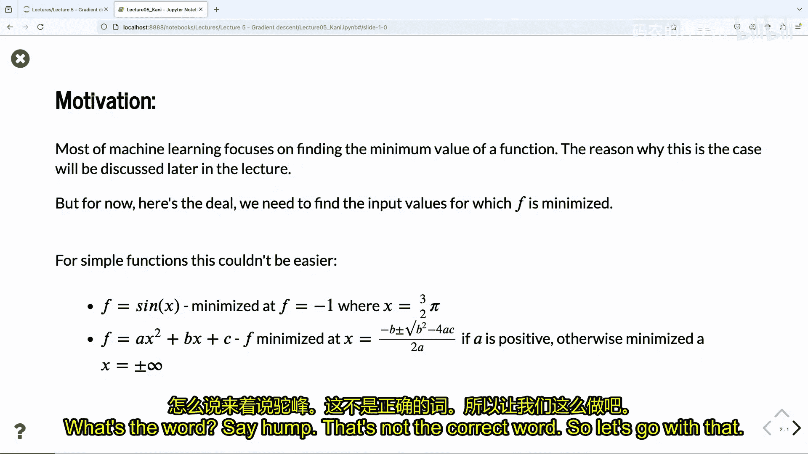
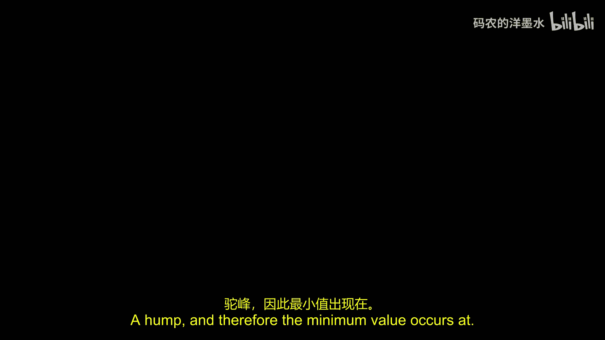

# 006：梯度下降 🎯

在本节课中，我们将学习梯度下降的核心概念。梯度下降是一种优化算法，它利用函数的梯度信息来寻找该函数的最小值点。我们将从动机开始，逐步理解其原理，并通过简单的函数和实际的数据拟合例子来掌握其应用。





---

## 动机：为何需要梯度下降？🤔

上一节我们介绍了计算图与反向传播，本节中我们来看看如何利用梯度来优化函数。

大多数机器学习任务的核心是找到某个特定函数的最小值。这个函数通常被称为“损失函数”。因此，机器学习在很大程度上就是关于最小化损失函数的过程。

对于某些简单函数，我们可以通过解析方法（例如求导并令其为零）轻松找到最小值。例如，对于正弦函数 `sin(x)`，其最小值出现在 `x = 3π/2` 处，函数值为 `-1`。对于二次函数 `f(x) = a*x^2 + b*x + c`，若 `a > 0`，其最小值出现在顶点处。

然而，对于复杂函数（例如一个六次多项式），解析求解可能非常困难且耗时。更重要的是，为每个特定函数手动推导解析解是不可复用的。我们希望找到一种通用的、可重复使用的算法来解决最小化问题。

---

## 迭代逼近法：一个朴素的想法 🔄

在引入梯度下降之前，我们先考虑一种朴素的迭代算法来寻找最小值。

其基本思想是：从一个初始猜测值 `x` 开始，然后稍微扰动 `x`（例如增加或减少一个小步长 `delta`），观察函数值 `f(x)` 的变化。如果函数值减小，则朝这个方向继续移动；如果函数值增大，则朝相反方向移动。同时，我们可以逐步减小步长，以更精细地接近最小值。

以下是该算法的伪代码描述：
```python
x = initial_guess
step_size = initial_step_size
while True:
    old_value = f(x)
    # 尝试正向扰动
    new_value_plus = f(x + step_size)
    # 尝试负向扰动
    new_value_minus = f(x - step_size)

    if new_value_plus < old_value:
        x = x + step_size
    elif new_value_minus < old_value:
        x = x - step_size
    else:
        # 两个方向都导致函数值增大，减小步长并可能反向
        step_size = step_size / 2
        # 可能需要改变方向，这里逻辑略复杂
    if step_size < tolerance:
        break
```

这个算法存在几个问题：
1.  **效率低下**：它是一个串行过程，每一步都需要多次计算函数值。
2.  **步长固定**：初始步长的选择很关键。步长太大会导致在最小值附近震荡甚至发散；步长太小则收敛缓慢，尤其在远离最小值时。
3.  **缺乏方向指导**：它只是盲目地试探左右两个方向，没有利用函数的局部形状信息。

---

## 梯度下降：利用梯度的智慧 📉

上一节我们看到了朴素迭代法的局限性，本节引入梯度下降算法，它利用梯度信息来智能地指导搜索方向并调整步长。

核心思想是：函数的梯度（导数）指明了函数值增长最快的方向。因此，要**最小化**函数，我们应该沿着梯度的**反方向**移动。梯度的大小也提供了信息：在陡峭的区域（梯度大），我们可以迈出更大的步子；在平缓的区域（梯度小），我们应该用小步幅谨慎移动，以免错过最小值。

梯度下降的更新公式如下：
`x_{k+1} = x_k - α * ∇f(x_k)`
其中：
*   `x_k` 是第 `k` 次迭代的参数值。
*   `∇f(x_k)` 是函数 `f` 在 `x_k` 处的梯度。
*   `α` 是**学习率**，它是一个正数，控制着每次更新的步长大小。

学习率 `α` 是一个超参数。梯度提供了更新的**方向**和**相对尺度**，而学习率则决定了步长的**绝对基准**。选择合适的学习率至关重要：太大可能导致震荡或不收敛；太小则收敛速度过慢。

让我们用一个简单的例子（最小化一个六次多项式）来演示。首先，我们手动计算该函数的导数（梯度）。然后应用梯度下降公式进行迭代。

```python
# 示例：最小化 f(x) = (1/3)*(x-12)^6
def f(x):
    return (1/3) * (x - 12)**6
def grad_f(x): # 手动计算的导数 f'(x) = 2*(x-12)^5
    return 2 * (x - 12)**5

x = 1.7 # 初始猜测
alpha = 1e-3 # 学习率
iterations = 100
for i in range(iterations):
    gradient = grad_f(x)
    x = x - alpha * gradient
    # 记录并可视化过程...
```
运行这段代码，我们会看到 `x` 从初始值 1.7 开始，随着迭代逐步接近函数的最小值点（大约在 x=0.8 附近）。梯度值在开始时较大，步长也较大；随着接近最小值，梯度变小，步长也随之减小，更新变得精细。

如果我们将学习率设置得过大（例如 `alpha=10`），更新步长就会过大，导致 `x` 在最小值两侧来回震荡，甚至发散，无法收敛。

---

## 梯度下降的挑战：局部最小值 🏔️

上一节我们成功用梯度下降找到了一个简单多项式的最小值，本节中我们来看看梯度下降面临的一个主要挑战。

梯度下降是一个局部优化算法。它总是沿着当前点的梯度反方向下降，这会导致它收敛到**最近的局部最小值**，而不一定是**全局最小值**。

考虑一个更复杂的函数：`f(x) = sin(log(x^2 + 1))`。这个函数有多个波谷（局部最小值）。如果我们从某个初始点（例如 `x=1.7`）开始运行梯度下降，算法可能会收敛到某个局部最小值（例如函数值为0的点），而不是更深层的全局最小值（函数值为-1的点）。

为了解决这个问题，在实践中常采用以下策略：
*   **多次随机初始化**：使用不同的随机初始参数多次运行梯度下降，然后选择所有结果中损失函数最小的那个。
*   **更先进的优化器**：例如带动量的优化器，可以帮助跳出一些浅的局部最小值。

这解释了为什么在机器学习中，报告模型性能时，给出多次随机种子下的结果范围比单一结果更有说服力。

---

## 目标函数与数据拟合 🎯

到目前为止，我们都在直接最小化一个函数 `f(x)`。但在机器学习中，我们更常见的任务是：找到参数，使得模型的预测值尽可能接近真实的数据标签。

这可以通过构建一个**目标函数**（或**损失函数**）来实现。例如，我们希望找到 `x`，使得 `f(x) = 0.5`。我们可以定义一个新的损失函数 `L(x) = (f(x) - 0.5)^2`。最小化 `L(x)` 就等价于寻找使 `f(x)` 接近 0.5 的 `x`。这里使用平方是为了保证误差为正且对正负偏差同等对待。

当有多个数据点 `(x_i, y_i)` 时，我们希望模型预测 `f(x_i)` 接近所有对应的 `y_i`。常用的**均方误差**损失函数为：
`L(θ) = (1/N) * Σ (y_i - f_θ(x_i))^2`
其中 `θ` 代表模型的所有参数。我们的目标是通过调整 `θ` 来最小化 `L(θ)`。

---

## 自动微分与PyTorch实践 🤖

上一节我们提到了损失函数，本节我们来看看如何利用自动微分工具（如PyTorch）高效地计算梯度并实施梯度下降，而无需手动求导。

手动或数值计算梯度对于复杂模型是不现实的。PyTorch使用**基于计算图的反向传播**来自动计算梯度。我们只需定义前向计算过程（构建计算图），然后调用 `.backward()` 方法，PyTorch就会自动计算所有需要梯度参数的梯度。

以一个简单的线性模型 `f(x) = A*x^2 + B*x + C` 拟合数据为例：

```python
import torch

# 1. 初始化可学习参数，requires_grad=True 告诉PyTorch跟踪其计算历史
A = torch.randn(1, requires_grad=True)
B = torch.randn(1, requires_grad=True)
C = torch.randn(1, requires_grad=True)

# 2. 定义模型和数据
def model(x):
    return A * x**2 + B * x + C

# 假设我们有一些真实数据 (x_data, y_data)
x_data = torch.linspace(-2, 2, 20)
true_A, true_B, true_C = 3, 2, 1
y_data = true_A * x_data**2 + true_B * x_data + true_C

# 3. 训练循环
optimizer = torch.optim.SGD([A, B, C], lr=0.01) # 使用SGD优化器
for epoch in range(1000):
    optimizer.zero_grad() # 清零梯度
    predictions = model(x_data)
    loss = torch.mean((predictions - y_data) ** 2) # 均方误差损失
    loss.backward() # 自动反向传播，计算梯度
    optimizer.step() # 根据梯度更新参数 (A, B, C)
    # 每隔一段时间打印损失值...
```
在这个例子中，我们完全没有手动计算 `A`、`B`、`C` 的梯度。PyTorch 的 `loss.backward()` 自动完成了基于计算图的反向传播。优化器 `optimizer.step()` 则根据学习率和梯度执行了参数更新 `θ = θ - α * ∇L(θ)`。

我们还可以用同样的方法拟合更复杂的模型，例如Sigmoid函数 `f(x) = 1 / (1 + exp(-(x - τ)/B))`，通过梯度下降来学习参数 `τ` 和 `B`，使其曲线拟合给定的数据点。

---

## 总结 📚

本节课中我们一起学习了梯度下降算法。

我们从优化函数的动机出发，先分析了一个朴素的迭代逼近法及其缺点。然后引入了梯度下降的核心思想：沿着梯度反方向更新参数以最小化函数，并强调了学习率的重要性。

我们探讨了梯度下降的一个主要局限——可能收敛到局部最小值而非全局最小值，并讨论了应对策略。接着，我们将问题扩展到机器学习更常见的场景：通过定义损失函数（如均方误差）来拟合数据。

最后，我们介绍了如何使用PyTorch的自动微分功能，无需手动推导梯度公式，即可高效地实现梯度下降，并完成了从简单多项式到Sigmoid函数的数据拟合实践。


梯度下降是深度学习乃至整个机器学习优化的基石，理解其原理和实现是构建更复杂模型的关键一步。