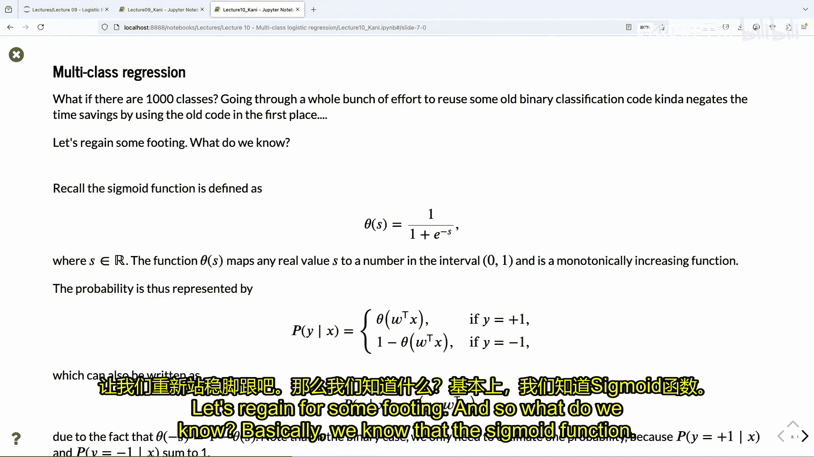

# 011：多分类逻辑回归

在本节课中，我们将要学习如何将二分类逻辑回归扩展到多分类问题。我们将回顾二分类的损失函数，介绍多分类的常见方法，并重点讲解Softmax回归的核心概念与实现。

---

## 概述

上一节我们介绍了用于二分类的逻辑回归及其交叉熵损失函数。本节中，我们来看看当类别数量超过两个时，应如何处理分类问题。我们将探讨“一对多”策略，并深入讲解更优雅、更常用的解决方案——Softmax回归。

---

## 二分类损失函数回顾

首先，我们简要回顾一下二分类中使用的模型和损失函数。

我们有一个数据集和对应的标签，在二分类中标签通常为0或1（或-1和1）。我们的目标是构建一个分类器。

**1. 线性回归与平方误差损失**
最初我们使用线性回归模型：`y = w^T x + b`。我们通过预测值 `y` 与真实标签之间的**平方误差**作为损失函数。对于简单数据集，这很有效。但线性模型本质上是在拟合一条直线，而分类数据是离散的（如0和1），这会导致模型拟合不佳，特别是对于远离决策边界的数据点，其产生的巨大残差会干扰模型参数。

**2. 逻辑回归与交叉熵损失**
为了解决上述问题，我们引入了**Sigmoid函数**（或称逻辑函数），将线性组合 `z = w^T x + b` 映射到(0,1)区间，输出可以解释为概率：`y = σ(z) = 1 / (1 + e^{-z})`。

此时，一个自然的想法是继续使用平方误差损失。但这里存在一个实践问题：当模型“自信地错误”时（例如，真实标签为1，但 `z` 为一个很大的负值，使得 `σ(z)` 接近0），损失函数值很大，但其**梯度却接近于0**。这导致模型难以通过梯度下降从错误中恢复，优化过程会非常困难。

因此，我们采用了**交叉熵损失**。对于二分类，其一般形式为：
`Loss = -[t * log(y) + (1 - t) * log(1 - y)]`
其中 `t` 是真实标签（0或1），`y` 是模型预测的概率。这个损失函数能提供更强的梯度信号：即使预测正确但不自信（例如 `t=1` 但 `y=0.6`），损失函数也会鼓励模型变得更自信。

---

## 从二分类到多分类

大多数现实世界的分类问题不仅仅是二元的，例如识别动物物种、汽车型号或成绩等级。我们需要构建能处理多个类别的模型。

**一对多分类策略**
一种思路是利用现有的二分类器。对于有C个类别的问题，我们训练C个独立的二分类器。第i个分类器负责判断“样本是否属于第i类”（将其视为正类，其他所有类别视为负类）。

预测时，我们将新样本输入所有C个分类器，选择输出概率（或置信度）最高的那个类别作为最终预测结果。

这种方法虽然可行，但当类别数量C很大时，需要训练和维护大量分类器，效率较低。

---

## Softmax回归

更优雅的方法是直接扩展逻辑回归，使其能输出一个样本属于每个类别的概率分布。这就是**Softmax回归**。

**核心思想**
我们希望模型输出一个向量，其中每个元素代表样本属于对应类别的概率。这个概率向量需要满足两个条件：
1.  每个概率值在0到1之间。
2.  所有类别的概率之和为1。

**Softmax函数**
Softmax函数正是为此设计。对于C个类别，给定样本的“逻辑值”（logits）向量 `z = [z_1, z_2, ..., z_C]`，其中 `z_i = w_i^T x + b_i`，Softmax计算第j类的概率为：
`P(y=j | x) = e^{z_j} / (Σ_{k=1}^{C} e^{z_k})`



**Softmax的特性**
*   **输出为概率分布**：每个输出值在(0,1)之间，且所有输出之和为1。
*   **放大差异**：由于指数函数的性质，即使逻辑值 `z_j` 只比其他 `z_k` 大一点，其对应的概率也会显著高于其他类别。这有助于模型做出明确的决策。
*   **可微性**：整个函数是可微的，便于使用梯度下降法优化。

**多分类交叉熵损失**
与二分类类似，我们使用负对数似然（即交叉熵）作为损失函数。对于真实类别为 `t` 的样本，其损失为：
`Loss = -log(P(y=t | x)) = -log( e^{z_t} / Σ_{k} e^{z_k} )`
`= -z_t + log( Σ_{k} e^{z_k} )`

这个损失函数的意义是：鼓励模型增大正确类别 `t` 的逻辑值 `z_t`，同时抑制其他类别的逻辑值，从而使正确类别的概率接近1。

---

## 实现与可视化

在实现时，我们需要为每个类别 `i` 维护一组独立的权重 `w_i` 和偏置 `b_i`。

**训练过程**
1.  初始化所有权重参数。
2.  对于每个样本，计算所有类别的逻辑值 `z_i`。
3.  应用Softmax函数得到概率分布。
4.  计算多分类交叉熵损失。
5.  通过梯度下降法更新所有权重 `w_i` 和 `b_i`。

**结果可视化**
当特征维度较高时，我们无法像二维数据那样直接绘制决策边界。一种有效的可视化方法是绘制**每个类别的概率随输入变化的曲线**。例如，在一维特征空间中，我们可以观察到：在属于某类样本聚集的区域，该类别的概率曲线会达到峰值，而其他类别的概率则较低，这符合我们的直观预期。

---

## 使用PyTorch简化实现

手动实现所有步骤有助于理解原理，但在实际应用中，我们应利用成熟的深度学习库。以下是如何使用PyTorch简化上述流程：

```python
import torch
import torch.nn as nn
import torch.optim as optim

# 定义模型（一个线性层，输出维度等于类别数C）
model = nn.Linear(input_dim, num_classes)
# 定义损失函数（内置的交叉熵损失函数已包含Softmax）
criterion = nn.CrossEntropyLoss()
# 定义优化器
optimizer = optim.SGD(model.parameters(), lr=learning_rate)

# 训练循环
for epoch in range(num_epochs):
    # 前向传播：计算逻辑值（logits）
    logits = model(x)
    # 计算损失（内部会计算Softmax和交叉熵）
    loss = criterion(logits, y_true_labels)
    # 反向传播
    optimizer.zero_grad()
    loss.backward()
    # 更新参数
    optimizer.step()
```

PyTorch的 `nn.CrossEntropyLoss` 将Softmax运算和交叉熵计算结合在一起，无需我们手动实现。优化器（如SGD、Adam）则负责高效地更新参数，其中可能包含动量等高级技巧。

---

## 总结

本节课中我们一起学习了多分类逻辑回归。
*   我们首先回顾了二分类逻辑回归及其交叉熵损失函数，理解了为何要放弃平方误差损失。
*   接着，我们探讨了将多分类问题转化为多个二分类问题的“一对多”策略及其局限性。
*   然后，我们重点学习了**Softmax回归**，它通过Softmax函数将多个线性输出转化为一个概率分布，并使用**多分类交叉熵损失**进行优化，这是处理多分类问题的标准方法。
*   最后，我们了解了如何使用PyTorch等现代库来高效、简洁地实现这些概念，这为我们后续的实践奠定了基础。


下一讲，我们将更深入地探讨PyTorch库，学习如何利用其模块化设计来构建更复杂的机器学习模型。