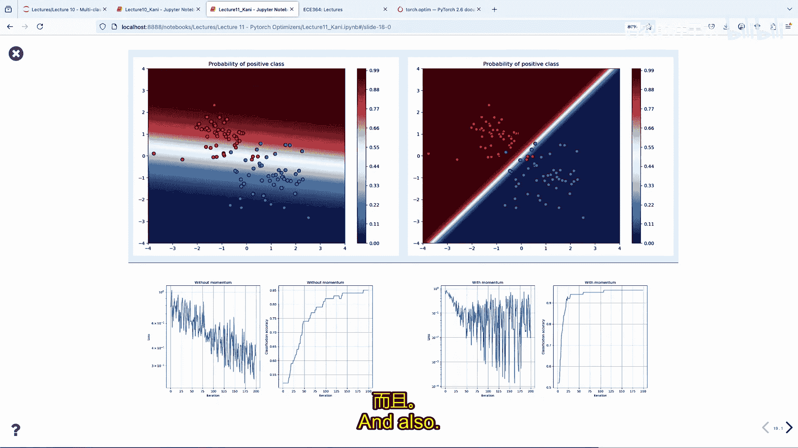
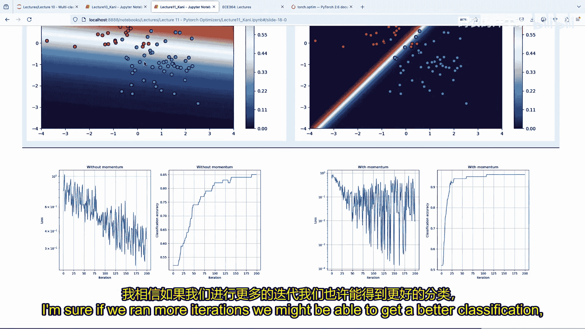
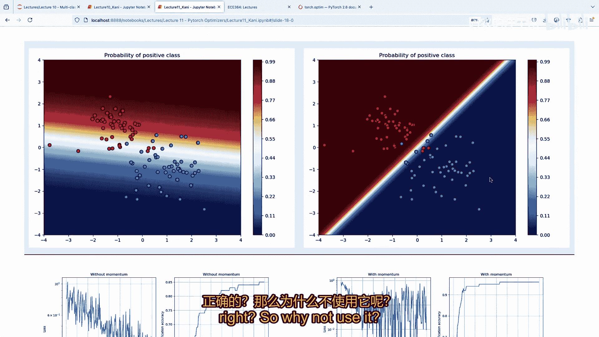
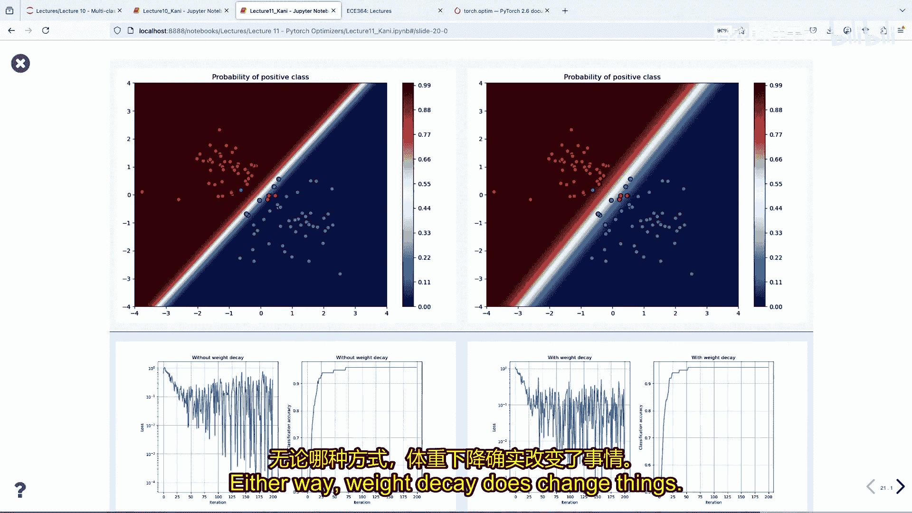
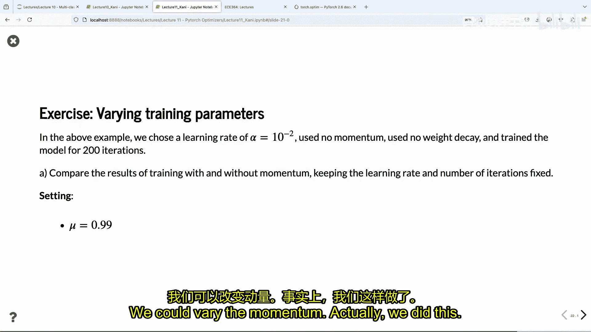
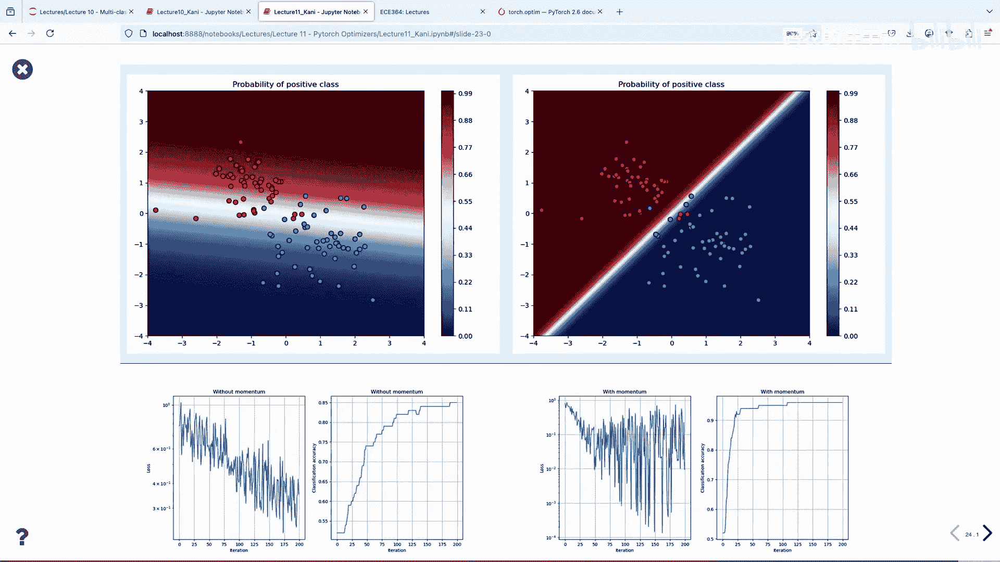
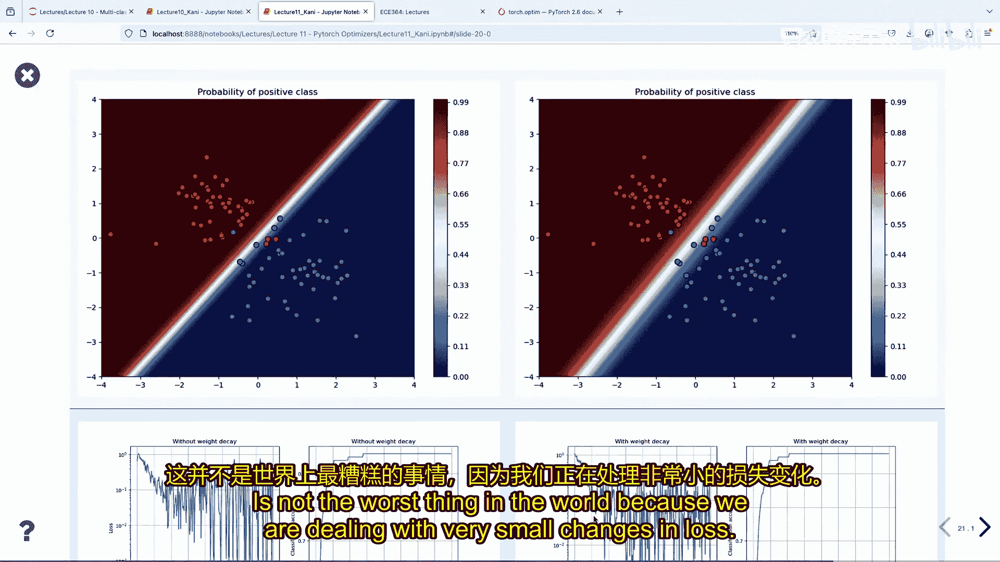
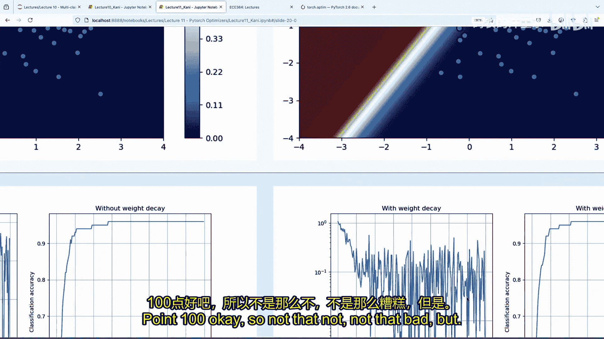

# 012：PyTorch神经网络模块与优化器 🧠

在本节课中，我们将学习如何使用PyTorch的`torch.nn`模块库和优化器来简化神经网络的构建与训练过程。我们将了解如何定义模型、损失函数和优化器，并通过一个分类示例来实践完整的训练流程。

---

## 概述

之前，我们手动计算损失梯度并更新参数，这对于复杂的神经网络架构（如Transformer）来说非常繁琐。PyTorch的`torch.nn`模块和优化器提供了高级工具，可以自动化这些过程，使代码更简洁、更易于管理。

## 模型、损失函数与优化器

在机器学习中，我们需要定义三个核心组件：
1.  **模型**：一个包含可学习参数θ的函数，用于将输入X映射到输出ŷ。
2.  **损失函数**：用于衡量模型预测ŷ与真实目标y之间的差异。
3.  **优化器**：根据损失函数的梯度更新模型参数的算法。

例如，在逻辑回归中：
*   **模型**：`ŷ = σ(w·x + b)`，其中σ是sigmoid函数。
*   **损失函数**：我们使用二元交叉熵损失，而不是均方误差损失，因为它能提供更好的梯度信号，尤其是在预测错误时。
*   **优化器**：我们使用梯度下降或其变种（如随机梯度下降）来更新权重w和偏置b。

## Python类与对象回顾

在深入PyTorch之前，我们先简要回顾一下Python中的面向对象编程概念，因为PyTorch的`nn.Module`就是基于类的。

*   **类**：是属性和方法的蓝图。例如，一个“圆形”类可能有`半径`属性和`计算面积`的方法。
*   **对象**：是类的具体实例。例如，可以创建两个“圆形”对象，一个半径为1，另一个半径为2。
*   **`self`关键字**：在类的方法中用于访问该对象自身的属性和方法。
*   **`__init__`方法**：是类的构造函数，在创建新对象时自动调用，用于初始化属性。

## PyTorch的`nn.Module`基类

`torch.nn.Module`是所有神经网络层和可训练模型的基类。通过继承它，我们可以方便地定义自己的模型。

定义自定义模型时，通常需要实现两个方法：
1.  **`__init__`**：构造函数，用于定义模型中的层和可学习参数。
2.  **`forward`**：定义数据的前向传播过程，即输入如何通过各层得到输出。

PyTorch的自动微分系统会根据`forward`方法构建计算图，用于后续的梯度反向传播。

### 示例：三阶多项式回归

假设我们的模型是 `f(x) = a*x³ + b*x² + c*x + d`，参数是a, b, c, d。

```python
import torch
import torch.nn as nn

class ThirdOrderPolynomial(nn.Module):
    def __init__(self):
        super().__init__() # 调用父类nn.Module的构造函数
        # 将a, b, c, d定义为可学习参数
        self.a = nn.Parameter(torch.randn(1))
        self.b = nn.Parameter(torch.randn(1))
        self.c = nn.Parameter(torch.randn(1))
        self.d = nn.Parameter(torch.randn(1))

    def forward(self, x):
        # 定义前向传播：y = a*x^3 + b*x^2 + c*x + d
        return self.a * x**3 + self.b * x**2 + self.c * x + self.d

# 使用模型
model = ThirdOrderPolynomial()
x_input = torch.tensor([2.0])
y_pred = model(x_input) # 等价于调用 model.forward(x_input)
print(f"参数: {list(model.parameters())}")
print(f"预测: {y_pred}")
```

**关键点**：
*   参数使用`nn.Parameter`封装，这会告诉PyTorch这些是需要优化的张量。
*   通过`model.parameters()`可以获取所有可学习参数。
*   调用`model(x_input)`会自动执行`forward`方法。

## 损失函数

PyTorch在`torch.nn`中提供了许多预定义的损失函数，如均方误差(`MSELoss`)、交叉熵(`CrossEntropyLoss`)等。它们也被实现为类。

```python
criterion = nn.MSELoss() # 创建损失函数对象
predictions = model(inputs) # 模型预测
loss = criterion(predictions, targets) # 计算损失
```

损失函数通常支持不同的“归约”方式：
*   `reduction='mean'`：计算所有数据点损失的平均值。
*   `reduction='sum'`：计算所有数据点损失的总和。
*   `reduction='none'`：返回每个数据点的损失值。

## 优化器

优化器负责根据损失函数的梯度更新模型参数。PyTorch在`torch.optim`中提供了多种优化器，最常用的是随机梯度下降。

### 随机梯度下降

在实际应用中，数据集可能非常大。**随机梯度下降**不是在整个数据集上计算梯度，而是在数据的一个小批量（mini-batch）上计算。这带来了几个好处：
*   **速度更快**：每次迭代计算量小。
*   **内存友好**：无需将全部数据载入内存。
*   **可能有助于逃离局部极小值**：由于梯度的随机性，优化路径可能更加“嘈杂”。

### 优化器的改进

SGD优化器可以配合多种技术以提升性能：
*   **动量**：在更新时考虑历史梯度方向，有助于加速收敛并减少震荡。
*   **权重衰减**：在每次更新时对权重施加一个小的惩罚（L2正则化），防止过拟合。
*   **学习率衰减**：随着训练进行，逐渐降低学习率，有助于在后期稳定收敛。

还有其他更高级的优化器，如**Adam**，它自适应地调整每个参数的学习率，在实践中非常流行。

### 使用优化器

以下是创建和使用SGD优化器的示例：

```python
import torch.optim as optim

model = ThirdOrderPolynomial()
criterion = nn.MSELoss()
optimizer = optim.SGD(model.parameters(), lr=0.01, momentum=0.9, weight_decay=1e-4)
```

**学习率选择**：没有固定公式。通常从一个小值开始尝试，观察损失曲线。如果损失下降太慢，尝试增大学习率；如果损失震荡或不下降，尝试减小学习率。

## 完整训练流程示例：逻辑回归分类

现在，我们将所有组件组合起来，解决一个二分类问题。

### 1. 准备数据

我们生成一个简单的二维数据集，包含两个类别。

```python
import matplotlib.pyplot as plt

# 生成数据
num_samples = 100
# 类别1的数据点，中心在(1, -1)
X1 = torch.randn(num_samples, 2) + torch.tensor([1.0, -1.0])
Y1 = torch.zeros(num_samples)
# 类别0的数据点，中心在(-1, 1)
X0 = torch.randn(num_samples, 2) + torch.tensor([-1.0, 1.0])
Y0 = torch.ones(num_samples)

# 合并数据
X = torch.cat([X1, X0], dim=0)
Y = torch.cat([Y1, Y0], dim=0)
```

### 2. 定义模型、损失和优化器

```python
class LogisticRegression(nn.Module):
    def __init__(self, input_dim):
        super().__init__()
        self.linear = nn.Linear(input_dim, 1) # 一个线性层，输出维度为1

    def forward(self, x):
        # 线性变换后通过sigmoid函数
        return torch.sigmoid(self.linear(x))

input_dim = 2
model = LogisticRegression(input_dim)
criterion = nn.BCELoss() # 二元交叉熵损失
optimizer = optim.SGD(model.parameters(), lr=0.1)
```

### 3. 训练循环

以下是训练循环的核心步骤：

```python
num_epochs = 100
batch_size = 20

losses = [] # 记录损失

for epoch in range(num_epochs):
    # 1. 清零优化器的梯度
    optimizer.zero_grad()

    # 2. 随机选择一个小批量数据
    indices = torch.randperm(len(X))[:batch_size]
    batch_X = X[indices]
    batch_Y = Y[indices].view(-1, 1) # 调整形状以匹配输出

    # 3. 前向传播：计算预测
    predictions = model(batch_X)

    # 4. 计算损失
    loss = criterion(predictions, batch_Y)
    losses.append(loss.item())

    # 5. 反向传播：计算梯度
    loss.backward()

    # 6. 优化器更新参数
    optimizer.step()
```

**流程解析**：
1.  `optimizer.zero_grad()`：在每次迭代前必须清除旧的梯度，否则梯度会累积。
2.  随机采样一个小批量数据。
3.  将数据输入模型，得到预测值。
4.  用损失函数计算预测值与真实值的差异。
5.  `loss.backward()`：通过计算图进行反向传播，为每个参数计算梯度。
6.  `optimizer.step()`：优化器根据计算出的梯度更新所有参数。

### 4. 结果可视化与比较

我们可以训练多个模型，比较不同设置（如是否使用动量）的效果。

*   **无动量**：损失下降平稳但可能较慢，决策边界可能不是最优。
*   **有动量**：损失初期下降更快，但曲线可能更震荡，通常能更快找到更好的决策边界。
*   **动量+权重衰减**：损失可能更稳定，模型参数值会被约束，可能获得更好的泛化能力。



通过绘制损失曲线和分类决策边界，可以直观地看到这些差异。





---



## 总结





本节课我们一起学习了如何使用PyTorch的高级工具来构建和训练神经网络。

1.  我们了解了机器学习流程的三个核心：**模型**、**损失函数**和**优化器**。
2.  我们学习了如何通过继承`nn.Module`基类来定义自己的模型，只需实现`__init__`和`forward`方法。
3.  我们熟悉了PyTorch中预定义的**损失函数**，如`MSELoss`和`BCELoss`。
4.  我们深入探讨了**优化器**，特别是随机梯度下降及其改进（动量、权重衰减），并学会了如何使用`torch.optim`中的优化器。
5.  最后，我们通过一个完整的逻辑回归分类示例，实践了从数据准备、模型定义到训练循环的整个流程。






使用`torch.nn`和`torch.optim`的最大优势在于**模块化**和**自动化**。它将复杂的梯度计算和参数更新封装起来，让我们能更专注于模型结构的设计和实验，从而更高效地开发机器学习应用。在接下来的课程中，我们将学习如何更高效地管理数据。