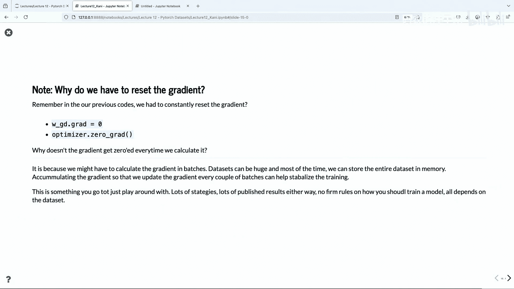

# 013：PyTorch数据集与数据加载器 🧠📊

在本节课中，我们将学习如何使用PyTorch的`Dataset`和`DataLoader`类来高效地组织、处理和加载数据。这是处理真实世界、大规模数据集的关键步骤，也是构建可复用、可维护机器学习代码的基础。

---

## 概述

上一节我们介绍了如何使用`torch.nn`模块和优化器来构建和训练模型。本节中，我们将重点关注数据的处理。我们将学习如何将数据集划分为训练集、验证集和测试集，如何创建自定义的`Dataset`类，以及如何使用`DataLoader`来批量加载和随机化数据，从而为模型训练做好准备。

---

## 机器学习问题的标准设置

在训练模型时，我们通常不会使用所有数据来拟合模型，因为我们希望模型能够泛化到未见过的数据。为此，我们将数据集划分为三个部分：

1.  **训练集**：用于训练模型、更新模型参数的数据子集。
2.  **验证集**：在训练过程中用于评估模型性能、调整超参数（如学习率、模型结构）的数据子集。模型不会根据验证集的数据来更新其权重。
3.  **测试集**：在模型训练和调优完成后，用于最终评估模型泛化能力的数据子集。测试集的结果通常作为模型性能的最终报告。

一个典型的划分比例是80%的数据用于训练，10%用于验证，10%用于测试，但这可以根据数据集大小进行调整。

---

## PyTorch Dataset 类

无论你是否喜欢面向对象编程，PyTorch都要求将数据集定义为一个类。`torch.utils.data.Dataset`是一个抽象类，要创建自定义数据集，需要继承它并实现三个方法：

*   `__init__`: 构造函数，用于初始化数据集（例如，加载数据文件或生成合成数据）。
*   `__len__`: 返回数据集中样本的数量。
*   `__getitem__`: 根据给定的索引`idx`，返回对应的数据样本（通常是输入和标签对）。

与`torch.nn.Module`不同，在`Dataset`的`__init__`中通常不需要调用`super().__init__()`。

以下是创建一个用于二分类的合成数据集的示例：

```python
import torch
from torch.utils.data import Dataset

class SyntheticDataset(Dataset):
    def __init__(self, sigma=0.1):
        # 生成合成数据：正类和负类各50个点
        self.positive_data = torch.randn(50, 2) + torch.tensor([2.0, 2.0])
        self.negative_data = torch.randn(50, 2) + torch.tensor([-2.0, -2.0])
        self.data = torch.cat([self.positive_data, self.negative_data], dim=0)
        self.labels = torch.cat([torch.ones(50), torch.zeros(50)])

    def __len__(self):
        # 返回数据集中样本的总数
        return len(self.labels)

    def __getitem__(self, idx):
        # 返回指定索引的输入数据和标签
        return self.data[idx], self.labels[idx]

# 使用数据集
dataset = SyntheticDataset()
print(f"数据集长度: {len(dataset)}")
sample_input, sample_label = dataset[0] # 获取第一个样本
```

使用`Dataset`类有助于保持代码的条理性，并且能统一访问不同来源（如Hugging Face、TorchVision）的数据集接口。

---

## PyTorch DataLoader 类

`DataLoader`是`Dataset`的一个强大封装，它简化了以下过程：

*   **批处理**：将数据分成小批量进行训练，这对于使用GPU进行高效计算和内存管理至关重要。
*   **随机化**：在每个训练周期（epoch）打乱数据顺序，防止模型因数据顺序而产生偏见。
*   **并行加载**：使用多进程提前加载数据，加速训练流程。

以下是使用`DataLoader`的示例：

```python
from torch.utils.data import DataLoader, random_split

# 1. 创建数据集
full_dataset = SyntheticDataset()

# 2. 划分数据集 (假设总长度为100)
train_size = int(0.8 * len(full_dataset))
val_size = int(0.1 * len(full_dataset))
test_size = len(full_dataset) - train_size - val_size

train_dataset, val_dataset, test_dataset = random_split(full_dataset, [train_size, val_size, test_size])

# 3. 创建 DataLoader
batch_size = 8
train_loader = DataLoader(train_dataset, batch_size=batch_size, shuffle=True)
val_loader = DataLoader(val_dataset, batch_size=batch_size, shuffle=False)
test_loader = DataLoader(test_dataset, batch_size=batch_size, shuffle=False)

# 4. 在训练循环中使用
for epoch in range(num_epochs):
    for batch_inputs, batch_labels in train_loader: # 自动进行批处理和迭代
        # ... 训练步骤 ...
        pass
```

---

## 整合训练：二分类逻辑回归

现在，我们将`Dataset`、`DataLoader`、`nn.Module`和优化器整合到一个完整的训练流程中。

首先，定义一个简单的二分类模型和准确率计算函数：

```python
import torch.nn as nn
import torch.optim as optim

class LogisticRegression(nn.Module):
    def __init__(self, input_dim):
        super().__init__()
        self.linear = nn.Linear(input_dim, 1) # 输出一个标量

    def forward(self, x):
        # 使用sigmoid函数将输出映射到[0,1]区间
        return torch.sigmoid(self.linear(x))

def calculate_accuracy(model, data_loader):
    correct = 0
    total = 0
    with torch.no_grad(): # 不需要计算梯度
        for inputs, labels in data_loader:
            outputs = model(inputs)
            predicted = (outputs > 0.5).float() # 将概率转换为0或1
            total += labels.size(0)
            correct += (predicted.squeeze() == labels).sum().item()
    return correct / total
```

接着，编写训练循环：

```python
# 初始化模型、损失函数和优化器
model = LogisticRegression(input_dim=2)
criterion = nn.BCELoss() # 二分类交叉熵损失
optimizer = optim.SGD(model.parameters(), lr=0.1, momentum=0.9)

num_epochs = 50
train_losses = []
train_accs = []
val_accs = []

for epoch in range(num_epochs):
    # 训练阶段
    model.train()
    epoch_loss = 0
    for batch_inputs, batch_labels in train_loader:
        optimizer.zero_grad() # 重要：清空上一批次的梯度
        outputs = model(batch_inputs)
        loss = criterion(outputs.squeeze(), batch_labels)
        loss.backward() # 反向传播计算梯度
        optimizer.step() # 更新参数
        epoch_loss += loss.item()

    # 记录训练损失和准确率
    avg_loss = epoch_loss / len(train_loader)
    train_losses.append(avg_loss)
    train_acc = calculate_accuracy(model, train_loader)
    train_accs.append(train_acc)

    # 验证阶段
    model.eval()
    val_acc = calculate_accuracy(model, val_loader)
    val_accs.append(val_acc)

    print(f"Epoch {epoch+1}: Loss = {avg_loss:.4f}, Train Acc = {train_acc:.4f}, Val Acc = {val_acc:.4f}")
```

训练完成后，你可能会观察到训练准确率高于验证准确率，这是正常现象，表明模型在训练集上可能有一定程度的过拟合。验证集的作用就是帮助我们监控这一点。

---

## 扩展到多分类：Softmax回归

对于多分类问题（例如有K个类别），我们需要使用Softmax回归。Softmax函数将模型的K个原始输出（logits）转换为一个概率分布，其中每个类别的概率在0到1之间，且所有类别概率之和为1。

**Softmax公式**：
对于第 `i` 个样本的 logits 向量 `z_i`，其属于第 `j` 类的概率为：
`P(class=j | x_i) = exp(z_ij) / Σ_k(exp(z_ik))`

在PyTorch中，我们可以使用`nn.Linear`层直接输出K个logits，并结合`nn.CrossEntropyLoss`损失函数（它内部已经包含了Softmax计算）来高效实现多分类。

```python
class MulticlassLogisticRegression(nn.Module):
    def __init__(self, input_dim, num_classes):
        super().__init__()
        self.linear = nn.Linear(input_dim, num_classes) # 输出维度等于类别数

    def forward(self, x):
        return self.linear(x) # 直接输出logits

# 用于4分类的合成数据集
class MulticlassDataset(Dataset):
    def __init__(self, num_classes=4, points_per_class=50):
        self.data = []
        self.labels = []
        for class_id in range(num_classes):
            # 为每个类别生成围绕不同中心点的数据
            center = torch.tensor([class_id * 2.0, class_id * 2.0])
            class_data = torch.randn(points_per_class, 2) + center
            self.data.append(class_data)
            self.labels.append(torch.full((points_per_class,), class_id))
        self.data = torch.cat(self.data, dim=0)
        self.labels = torch.cat(self.labels, dim=0)

    def __len__(self):
        return len(self.labels)

    def __getitem__(self, idx):
        return self.data[idx], self.labels[idx]

# 训练流程与二分类类似，主要区别在于模型和损失函数
model_multi = MulticlassLogisticRegression(input_dim=2, num_classes=4)
criterion_multi = nn.CrossEntropyLoss() # 多分类交叉熵损失（包含Softmax）
optimizer_multi = optim.SGD(model_multi.parameters(), lr=0.1)

# ... 数据加载和训练循环的结构与之前相同 ...
```

使用矩阵运算（`nn.Linear`）一次性计算所有样本和所有类别的logits，能充分利用GPU的并行计算能力，极大提升训练效率。

---

## 关于梯度清零的说明

你可能会好奇，为什么在每次反向传播前都需要调用`optimizer.zero_grad()`来手动清零梯度？这是因为PyTorch中的梯度是**累积的**。设计成这样是为了提供灵活性：

*   有时你可能想在一个批次（batch）上多次计算梯度（虽然不常见）。
*   更常见的是，你希望基于一个批次的数据计算一次梯度并更新参数。手动清零确保了每次`optimizer.step()`都是基于当前批次计算出的梯度，而不会混入之前批次的梯度信息。

---

## 总结

本节课中我们一起学习了PyTorch中数据处理的核心组件：

1.  **数据集划分**：理解了训练集、验证集和测试集的作用与划分原则。
2.  **`Dataset`类**：学会了如何通过继承`Dataset`类来创建自定义数据集，必须实现`__init__`、`__len__`和`__getitem__`方法。
3.  **`DataLoader`类**：掌握了使用`DataLoader`进行批处理、数据随机化和并行数据加载，这是高效训练模型的关键。
4.  **完整训练流程**：将`Dataset`、`DataLoader`、模型(`nn.Module`)、损失函数和优化器整合到一个标准的训练循环中。
5.  **从二分类到多分类**：了解了如何使用`nn.Linear`和`nn.CrossEntropyLoss`轻松地将逻辑回归模型扩展到多分类问题，并理解了其背后的Softmax原理。
6.  **梯度累积**：明白了为何需要在训练循环中手动清零梯度。




通过使用这些工具，你可以构建出结构清晰、易于维护且能够处理大规模真实数据的机器学习项目。