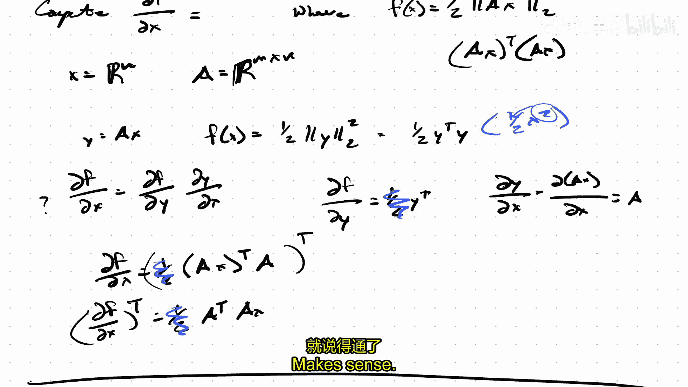
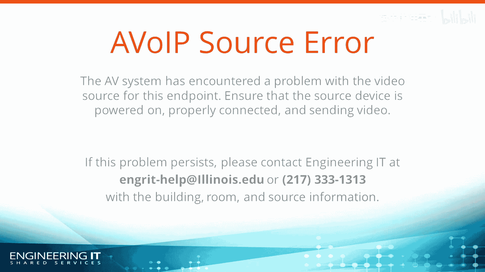

# 014：期中复习

在本节课中，我们将回顾期中考试前所学的核心概念，包括张量操作、线性代数、矩阵微积分和计算图。我们将通过分析示例问题来巩固理解，确保大家为考试做好充分准备。

---

## 张量操作回顾

上一节我们介绍了课程的整体结构，本节中我们来看看张量操作的基础知识。张量是PyTorch中的核心数据结构，理解其内存管理和视图机制至关重要。

### 内存共享与视图

张量视图可以共享底层数据内存，而无需分配新内存。使用带下划线的操作符（如 `.add_()`）会进行原地操作，保持张量的属性（如 `requires_grad`）不变。

以下是判断张量是否共享内存的示例：

```python
import torch

def same_storage(a, b):
    return a.storage().data_ptr() == b.storage().data_ptr()

a = torch.zeros(3, 2)
b = a.cos_()  # 原地操作，修改a的数据
c = a + b     # 非原地操作，创建新张量

print(same_storage(a, b))  # 输出: True
print(same_storage(b, c))  # 输出: False
print(a)  # 张量a和b的值都变为全1
print(b)  # 张量a和b的值都变为全1
print(c)  # 张量c的值为全2
```

### 张量切片与索引

PyTorch的切片语法与NumPy类似，是一种高效的数据访问方式。可以使用布尔掩码进行条件索引。

以下是获取矩阵右上象限和特定列中满足条件元素的示例：

```python
import torch

# 创建一个10x10的随机整数张量
a = torch.randint(-99, 100, (10, 10))

# 获取右上象限（假设为正方形矩阵）
n = a.shape[0]
d = a[:n//2, n//2:]  # 行：前一半，列：后一半

# 获取第三列（索引为2）中能被4整除的元素
col_index = 2
e = a[:, col_index]  # 获取整列
h = e[e % 4 == 0]    # 使用布尔掩码进行条件筛选
```

---

## 线性代数与矩阵微积分

在掌握了张量基础后，我们进入线性代数部分，核心是矩阵微积分，这对于理解机器学习中的梯度计算至关重要。

### 矩阵微积分示例

考虑函数 **f(x) = (1/2) ||Ax||²**，其中 **x** 是向量，**A** 是矩阵。我们想求 **f** 对 **x** 的偏导数 **∂f/∂x**。

我们可以使用链式法则。令 **y = Ax**，则 **f = (1/2) yᵀy**。
根据链式法则：
**∂f/∂x = (∂f/∂y) * (∂y/∂x)**

计算各分量：
*   **∂f/∂y = yᵀ** （因为 **∂(yᵀy)/∂y = 2yᵀ**，与1/2相乘后为 **yᵀ**）
*   **∂y/∂x = A**

因此：
**∂f/∂x = yᵀ A = (Ax)ᵀ A = xᵀAᵀA**

另一种写法是取其转置，这在矩阵微积分中常被接受：
**(∂f/∂x)ᵀ = AᵀAx**

---

## 计算图与反向传播




对于复杂函数，手动计算梯度非常繁琐。计算图通过将函数分解为节点和边，并应用链式法则自动计算梯度，这就是反向传播的原理。

### 计算图构建与梯度计算

给定函数 **f(x, y) = 2cos²(xy) + ln(cos(xy))**，我们需要为其构建一个计算图，并计算关于输入 **x** 和 **y** 的梯度。

首先，我们手动验证梯度：
*   **∂f/∂x = -4y cos(xy) sin(xy) - y sin(xy)/cos(xy)**
*   **∂f/∂y = -4x cos(xy) sin(xy) - x sin(xy)/cos(xy)**

接着，我们将其适配到以下计算图结构，并为每个节点 `Wi` 分配操作：


以下是可能的赋值方案（前向传播）：
*   `W1 = x`
*   `W2 = y`
*   `W3 = W1 * W2` (即 `xy`)
*   `W4 = cos(W3)`
*   `W5 = (W4)²`
*   `W6 = 2 * W5`
*   `W7 = ln(W4)`
*   `W8 = W6 + W7` (即输出 `f`)

然后进行反向传播，计算每个节点的局部偏导数和伴随（adjoint）：
1.  **∂W8/∂W6 = 1**, **∂W8/∂W7 = 1**
2.  **∂W6/∂W5 = 2**
3.  **∂W7/∂W4 = 1/W4**
4.  **∂W5/∂W4 = 2W4**
5.  **∂W4/∂W3 = -sin(W3)**
6.  **∂W3/∂W1 = W2**, **∂W3/∂W2 = W1**

从输出开始反向累乘：
*   `W8_bar = 1`
*   `W6_bar = W8_bar * 1 = 1`
*   `W7_bar = W8_bar * 1 = 1`
*   `W5_bar = W6_bar * 2 = 2`
*   `W4_bar = W7_bar * (1/W4) + W5_bar * (2W4) = 1/W4 + 4W4`
*   `W3_bar = W4_bar * (-sin(W3))`
*   `W1_bar = W3_bar * W2`
*   `W2_bar = W3_bar * W1`

将 `W1=x`, `W2=y`, `W3=xy`, `W4=cos(xy)` 代入 `W1_bar` 和 `W2_bar`，得到的结果与手动计算的 **∂f/∂x** 和 **∂f/∂y** 一致。

---

## 总结

本节课中我们一起回顾了期中考试的核心内容：
1.  **张量操作**：理解了内存共享、视图、原地操作以及高效的切片和索引技术。
2.  **矩阵微积分**：练习了使用链式法则计算向量值函数对向量的偏导数，这是机器学习中梯度计算的理论基础。
3.  **计算图与反向传播**：通过一个具体例子，学习了如何将复杂函数分解为计算图，并应用反向传播算法自动、高效地计算梯度。



考试将涵盖截至上一讲的所有内容，包括作业中的知识点。请结合在线发布的样题、本节课的示例以及作业进行复习。祝大家备考顺利！