# 015：多层感知器 🧠

在本节课中，我们将要学习如何构建多层感知器，理解激活函数的重要性，并学习如何在PyTorch中实现它们。我们将从一个简单的逻辑回归模型出发，探讨其局限性，然后逐步引入更复杂的多层网络结构来解决非线性可分问题。

---

## 概述

在课程的前半部分，我们讨论了构建深度神经网络所需的主要工具，包括梯度下降、优化以及PyTorch提供的各种实用功能。我们还讨论了链式法则和计算图。现在，我们知道如何将函数拟合到数据集上。既然我们已经知道如何将一些简单函数拟合到数据集，并且拥有了进行这种拟合所需的所有工具，那么接下来的方向就是构建更复杂的函数。这就是我们将在课程后半部分讨论的内容。我们将讨论更复杂、更深、更大的神经网络，以及不同的架构。今天，我们将从一个非常简单的深度神经网络版本开始，即多层感知器。

我们将讨论多层网络的构建、激活函数的用途、为什么需要激活函数，以及在PyTorch中创建这些多层网络的方法，其中包含大量示例代码。下次课，我们将讨论卷积神经网络，然后是循环神经网络、高斯混合模型、主成分分析等。这些内容将是面试中经常被测试的核心知识。

---

## 回顾逻辑回归

上次我们讨论的分类模型是逻辑回归。它效果相当不错。让我们回顾一下它是什么。基本上，我们有一个线性模型，并将其与某个逻辑方程配对。我们将线性模型传递给一个逻辑方程，这就是逻辑回归模型。

在线性模型中，Z的每个组成部分被称为“逻辑单元”。然后，我们将这些逻辑单元传递给一个逻辑模型。如果进行二元分类，我们可以使用简单的Sigmoid模型。如果进行多类逻辑回归，我们使用Softmax函数，这基本上是将Sigmoid模型扩展到多个不同的类别。

现在开始，我们将主要通过Softmax来处理所有事情。我们需要做的就是拥有一个线性模型，它接收一组输入X，然后产生一个线性输出。接着，我们将这个线性输出传递给Softmax函数，以获得模型认为输入属于特定类别的概率。

---

## 非线性可分数据集

逻辑回归在许多数据集上效果很好。但让我们来看一个我们之前没有见过的新例子。让我们构建一个新的数据集，其中包含两个不一定线性可分的类别。我们想探索逻辑回归的局限性。

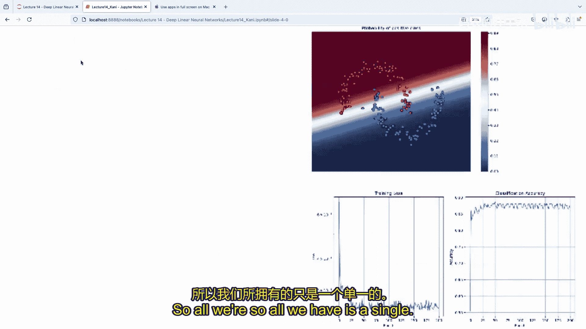

我们通过计算两个圆并添加一些随机噪声来创建这个数据集。这个数据集的构造细节并不重要。重要的是，没有一条直线可以完美地将这两个类别的值分开。如果我们尝试画任何一条线，都会有很多值被错误分类。这就是所谓的非线性可分数据集。

这一点很重要，因为有些优化方法（例如支持向量机中的硬间隔方法）要求数据集先验地是线性可分的。在我们的数据集中，情况并非如此。

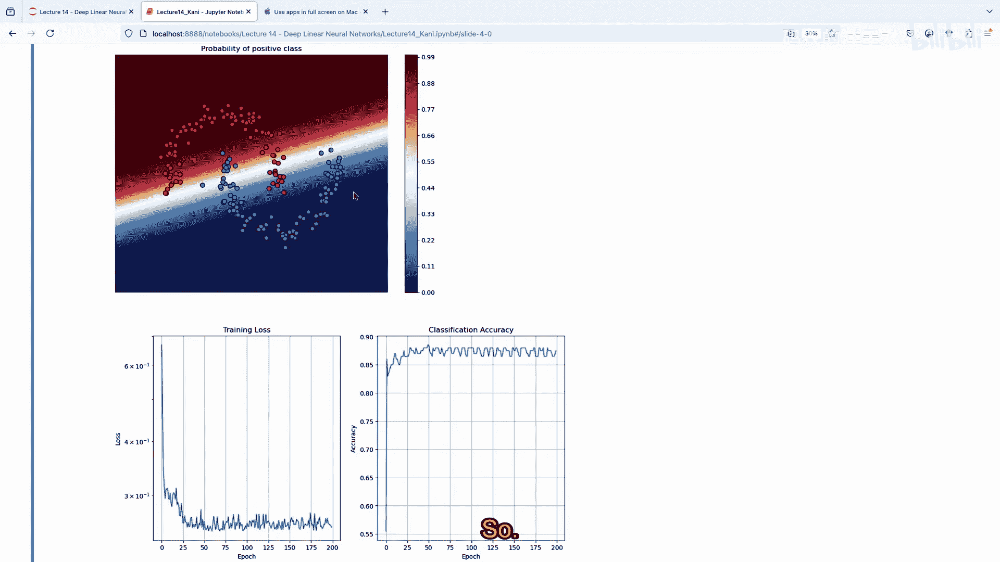

---

## 逻辑回归的局限性

现在，让我们在这个数据上尝试逻辑回归模型。为了这个练习的目的，我们暂时不担心创建单独的训练、验证和测试集。这只是一个概念验证。

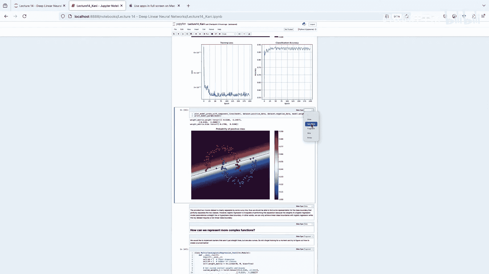

让我们从视觉上回顾一下我们的逻辑回归模型。它是一个线性模型，后面跟着一个逻辑函数。这里我们引入一个新术语：**感知器**。感知器是一个函数，它接收一个逻辑单元，并输出特定激活函数的结果。整个结构被称为感知器。当我们谈论多层感知器时，指的是这个感知器馈入另一个感知器，再馈入另一个，依此类推。

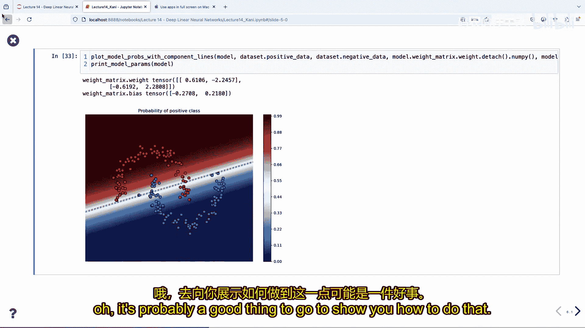

我们有一个单一的感知器：线性模型 `x1 * w1 + x2 * w2 + b`，将它们求和得到一个特定的逻辑单元，然后将这个逻辑单元传递给一个逻辑函数（即Softmax）。让我们用代码实现它。

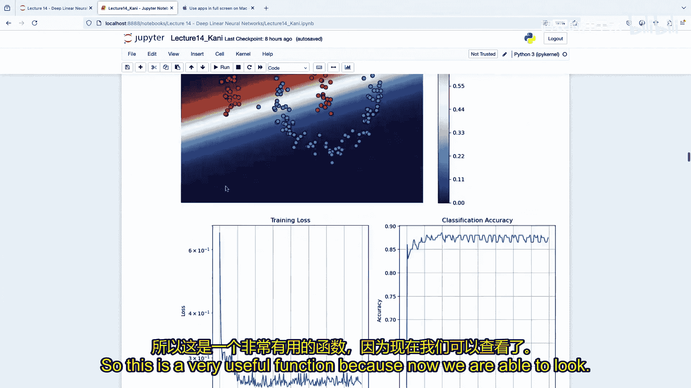

当我们运行代码时，我们得到了一个分类边界。它很直观，但并不理想。这是有道理的，因为整个问题在于这个数据集不是线性可分的。目前，我们只有一个线性感知器可用。我们只有这个线性函数，它馈入一个S形曲线。我们能得到的边界是一条直线，这是它的极限。我们无法得到曲线，因为这本质上是 `x1*w1 + x2*w2 + b` 的和。

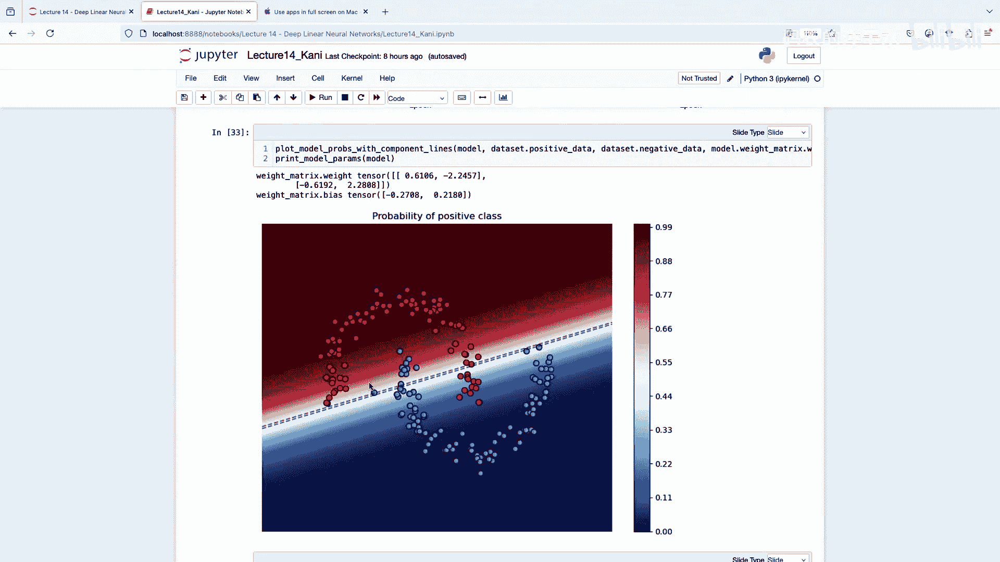

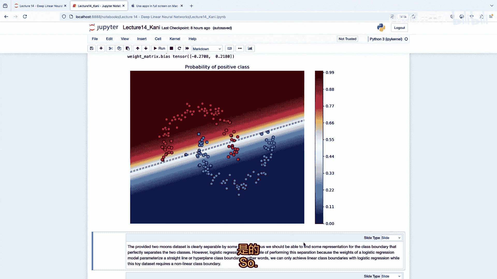

当我们将其输入模型时，它会尝试让这条直线尽可能好地拟合数据。说实话，它做得并不算太差。损失从很高的值开始，然后我们得到那种指数衰减曲线，最终稳定在一个特定的损失值附近。分类准确率最终稳定在80.7%左右。

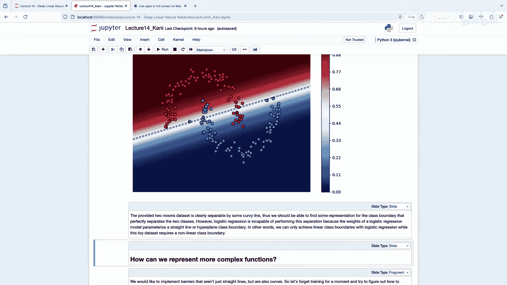

这是有道理的，因为这条线能做到的最好情况就是正确分类大部分点，但总有一些边缘的点无法正确分类。这已经是最好的直线了，因为如果我们尝试其他方向的直线，会有更多的值被错误分类。好消息是，模型按预期工作。坏消息是，预期的功能不足以满足我们的需求。我们真正想要的是一个能够围绕类别弯曲自身的边界。

---

## 引入多层网络

问题变成了：我们如何得到曲线边界？具体来说，让我们看看实际的函数。让我们看看实际的模型类。在多类逻辑回归中，它只是一个权重矩阵。我们有一个输入维度，还有一个类别数量。多类线性回归本质上是一个矩阵。重要的是要记住，这个权重矩阵就是这个线性部分。我们还有一个偏置项。

如果我们知道 `Z = W1 * X + B1`，我们可以绘制这条边界线。事实上，我们正是这样做的。我们可以通过查看特定的权重矩阵和偏置来绘制边界，并绘制它们等于什么。我们只需进入模型，循环所有需要梯度的命名参数，然后打印这些参数。这是一个非常有用的函数，因为现在我们能够看到PyTorch优化出的理想分离边界。

重申一下，问题在于只有一个分离边界。因为我们使用Softmax，所以对于正类和负类各有一个边界。我们想要的是，我们的双月数据集显然可以用一条曲线分开，但目前我们只有一条直线。我们该怎么办？如果我们有更多的直线呢？如果我们有更多的分离边界，然后把它们加在一起呢？这就是多层网络背后的思想。这就是我们接下来要做的。

让我们尝试一下。我们想实现不仅仅是直线，还有曲线的边界。暂时忽略训练和优化，我们如何得到一个曲线边界？假设我们有以下代码。我有两个特定的值，这个权重矩阵可以取这两个值。这和我为逻辑回归做的类完全一样，只是直接修改了实际值。

我设置了两个不同的值。让我们看看第一个自定义权重。同样，我没有进行优化。这只是一组随机值，定义了代码中的一组特定边界，即直线。我有多类逻辑回归的权重矩阵，我有一组特定的值。我将这些特定的值复制到权重矩阵中。顺便说一下，以这种方式做事很重要，因为如果你尝试用其他方式，比如直接定义一个张量，你会失去很多线性函数等功能。所以这就是我这样做的方式。我只是将值复制到线性权重中。

如果我们使用第一组自定义权重和偏置，我们得到一条特定的直线，不是最优的，但也不算太差。这是一个边界。现在，如果我们将其更改为其他值。注意，自定义权重和偏置1与自定义权重和偏置2之间的唯一区别是X和偏置上的负号。那么预期的边界是什么？如果我们改变这里的负号，边界会沿着X轴翻转。如果我们再次运行它，理想情况下，它会沿着X轴翻转。所以我们有两个不同的边界。一个像这样，另一个像这样。

我们想要的是能够将这两个边界加在一起。这就是我们想要的。我们希望能够将这两个特定的边界相加，得到边界的总和，从而得到某种曲线。那么我们该怎么做呢？我们可以通过拥有两层而不是一层来实现。是的，你可以通过训练多个逻辑回归模型，然后为每个类别选择最自信的那个，这是同样的思路。你可以这样做，但如果有很多边界，会有点繁琐。我打算提出一个稍微不同的方法。

我们可以创建一个新模型。之前我们有一个单一的感知器，它馈入逻辑回归。现在，我们有两个感知器，有两个权重（应该是W3和W4，这里标记有误）和偏置B2。我们需要做的不是只有一个馈入Sigmoid函数的逻辑单元，而是将两个逻辑单元求和后馈入Sigmoid函数。让我们看看在这种情况下我们得到什么。

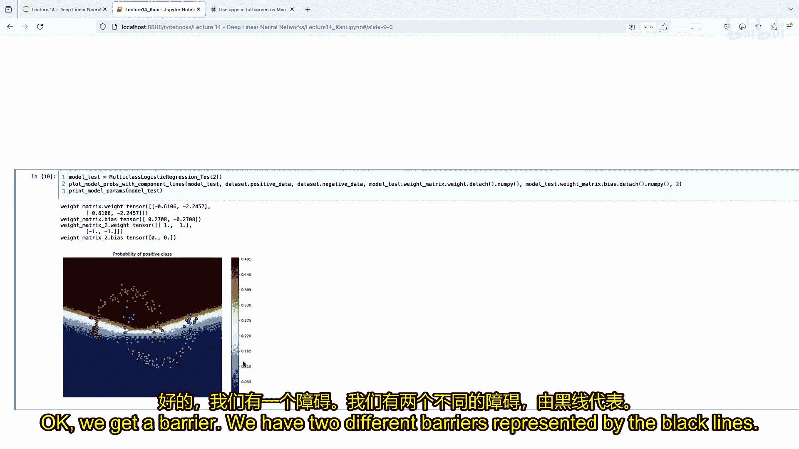

在代码中，我们只需要同时拥有两个边界函数。所以在这种情况下，我们有第一个带偏置的边界函数，然后是第二个边界函数，它的X值和偏置值符号相反。我们简单地定义每个边界函数一行。然后我们将其乘以X。这将给我们Z1和Z2。这个权重矩阵乘以X得到Z1和Z2。然后，如果我们想把这两个加在一起，我们只需将其乘以一个2x1矩阵。在这个例子中，我乘以一个2x2矩阵，但我这样做只是因为第一行代表正类，第二行代表负类。同样，我们使用多类交叉熵、多类Softmax逻辑回归。所以我们必须为每个正类和负类都有一个输出。从视觉上看，我们在想正类的概率是多少，因为正类的概率应该是1减去负类的概率。但在代码中，我们必须为每个类都设置一个输出。这就是为什么有第二个输出。我有两行，因为我需要一行为正类，一行为负类。但除此之外，这并不重要。为了得到正类输出，我只需要将两个边界相加。为了将两个边界相加，我只需乘以一个1x2矩阵。因为Z是一个2x1矩阵，我乘以一个1x2矩阵，然后将两个逻辑单元相加。这说得通吗？

我没有添加任何偏置。你可以稍后调整偏置。但这就是这个类所做的。基本上只是定义了两个不同的线性模型，然后将两个不同的线性模型相加。因为我们使用交叉熵Softmax，它添加了逻辑函数。我们得到一个特定的边界。我们得到两个由黑线表示的不同边界。由于我在第一层添加了偏置，因此存在垂直偏移。但最重要的是，通过将两条不同的边界线相加，你得到了一条曲线。希望看到这一点后，你会明白为什么添加更多的边界曲线可以得到更复杂的形状。你可以得到更复杂的边界，更复杂的分离。

这说得通吗？所以我们进行多类、需要多层的原因是因为我们想要定义多个潜在的边界。然后我们需要另一层来将这些边界相加。为了得到更复杂的东西。然后如果我们想变得更复杂，比如三层、四层。这是同样的思路，变得更复杂。假设我们想进入三层。如果我们有一个这样的边界和另一个这样的边界，在第二层上我们会有两个曲线边界，然后我们想把这两个曲线层总结、加总到第三层的一个超级曲线层上。这说得通吗？

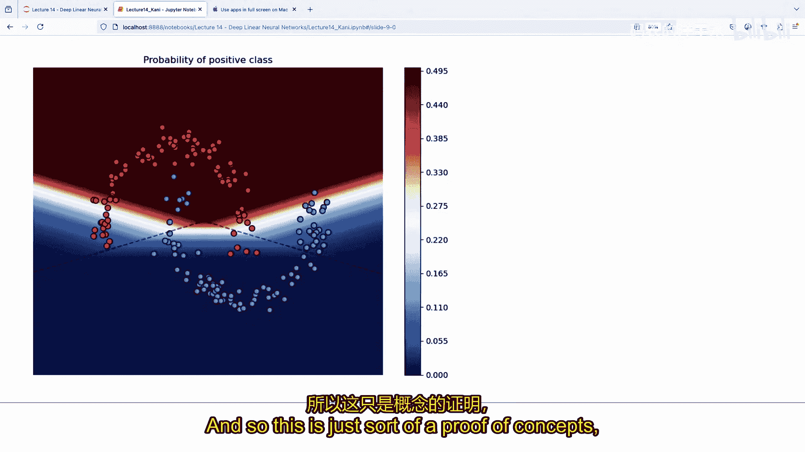

这就是为什么多层变得重要。这只是一个概念证明。但我们可以做更复杂的事情。我不知道你们有多少人注意到了，但在我定义这个模型时，我做了一件非常重要的事情。具体来说，我通过一个特定的激活函数将这两层分开。我们之前讨论过激活函数，Sigmoid函数是一个特定的激活函数，ReLU是一个特定的激活函数。激活函数只是一个非线性函数，它接收特定输入并将其映射到特定输出。

现在的问题是：我为什么要这样做？我为什么要把第一层和第二层用一个特定的激活函数分开？让我现在回答这个问题。让我们快速尝试一下没有ReLU的情况。所以我们有多类线性回归，我在这里注释掉了ReLU。那么在这种情况下会发生什么？如果我运行它，我再次得到一条直线。我可以向你保证，我在这里没有做任何优化。我没有做任何优化。记住，在这个模型中，我只是手动设置第一层的边界。这些是我的边界，我手动设置好了。这些边界仍然相同。我仍然在这里绘制这些边界。但不同之处在于，我不是在这两层之间使用某个激活函数，而是简单地将这些边界相乘并求和后输出。

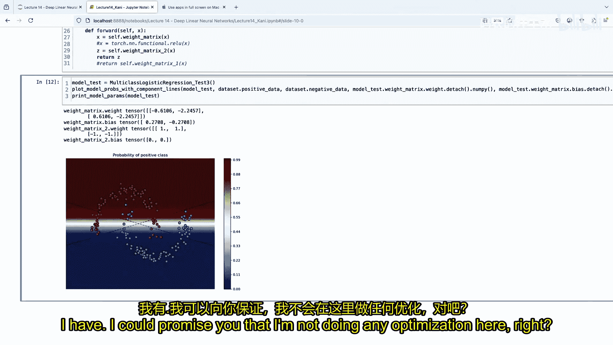

之前我有那些边界，我通过一个激活函数传递它们，然后对它们求和。现在，我取这些层的整个值，只是对它们求和然后输出。这样做，做第二件事，会给我们带来不好的结果。它并没有给我们带来坏的结果，只是给了我们不想要的东西。它给了我们两个边界函数的和。但两个边界函数的和只是一条直线。这不是我们之前想要的曲线。

那么那个激活函数有什么特别之处呢？让我们想一想。没有ReLU，输出仅仅是：第一层进入第二层加上偏置。在这种情况下，我们将偏置设为0，没有激活函数。然后如果我们进行数学计算，我们完全可以做到。这只是正常的代数函数。我们可以展开这个函数。我们可以将W2乘以W1x，将W2乘以B1。然后我们得到一个新的激活函数，即 `W2 * W1 * x + W2 * B1 + B2`。

如果我们层与层之间没有任何东西，数学上这仍然只是一个线性函数。实际上，模型只会将这里的这两个权重矩阵视为一个单一的权重矩阵。它将以与只有一个单一权重矩阵相同的方式进行优化。它保持不变。它仍然是一个线性函数。所以你只是在做一个大的矩阵乘法。而且，偏置只是一个单一的值，一个常数值。它只会将直线上移、下移、左移、右移。它不会真正改变线性性质，所以这没有帮助。

拥有激活函数的特别之处在于它打破了模型的线性。以修正线性单元为例，ReLU只是一个激活函数，如果输入正值，它就传递该正值；如果输入负值，它就输出0。基本上，它永远不会输出小于0的任何值。激活函数看起来像这样。所以在这种情况下，因为这个值不是线性的，它对负数进行了阈值处理，所以它是一个非线性函数。那么新的函数变成了 `W2 * ReLU(W1 * x)`。这个W2不能通过ReLU函数传递并与W1x相加。因此，你有了两个独立的层。因为你有两个独立的层，所以你得到了那条曲线。

ReLU通过将输入向量的负分量清零来弯曲输入空间。正因为如此，网络在输入空间的不同区域表现不同。这就是为什么你得到那条漂亮的曲线。因为在左侧区域，一个边界突出，在右侧区域，另一个边界突出。当其中一个边界变为负值时，ReLU基本上使该边界消失。所以你得到了一个漂亮的曲线。

---

## 回到双月例子

回到我们的双月例子，知道了我们所知道的，我们要做的就是定义两个不同的层。我们将定义两个不同的层，并使中间层具有一定数量的元素。在这个例子中，我们将使中间层有8个元素。所以我们有一堆输入。现在我们要映射到一堆所谓的中间层或隐藏层。然后我们将把这些中间层的输出传递给输出层。

我们可以选择任意数量的元素。我们可以选择中间层的任何大小。在双月例子中，我们可以选择大小为8。这并不重要。我们仍然有大小为2的输入。输入是二维的。我们有一个大小为2的输出类别。所以我们有一个2个元素的层。然后我们有一个8个元素的隐藏层。然后我们再次有一个2个元素的输出层。

我们像这样定义模型。最重要的是，我们在两层之间添加了一个非线性激活函数。这使我们能够以围绕类别弯曲总和边界的方式组合边界。然后我们进行优化。拥有8个隐藏层意味着我们有8个不同的边界。我们完成所有这些，然后我们得到一个函数。它看起来相当不错。它是一个漂亮的曲线层，它围绕类别弯曲。所以，之前我们有一条单一的直线，现在我们有效地得到了多条直线。

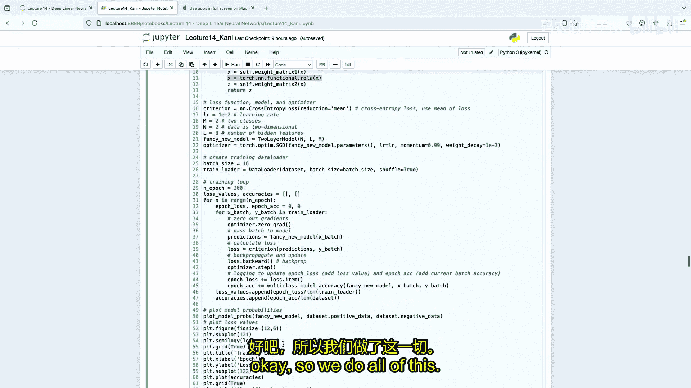

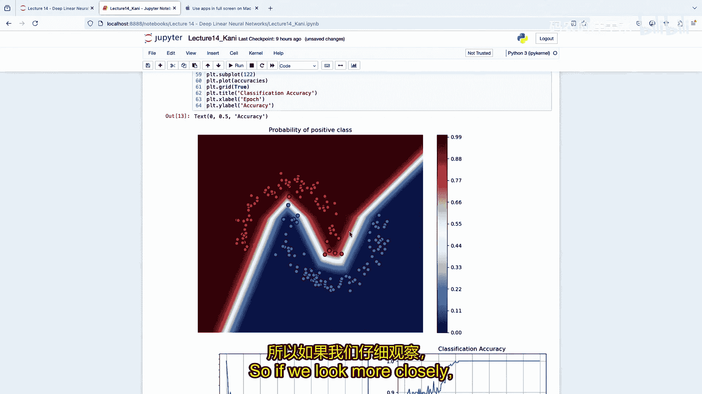

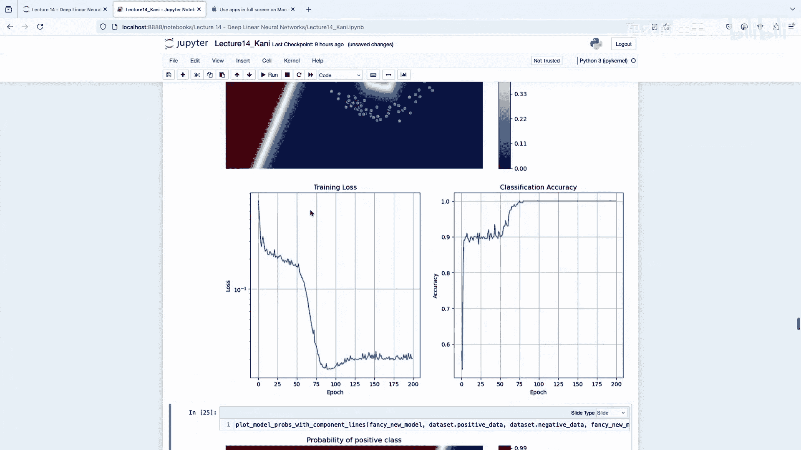

如果我们更仔细地看，如果我们查看这个权重矩阵的实际值，查看第一个矩阵权重矩阵的实际值，然后绘制它们，我们会发现由第一个权重矩阵定义了八个不同的边界。这里的每条黑线对应一个不同的权重矩阵。然后这些黑线全部相加，给你一个围绕不同半月的总和边界，基本上在二维空间中给你一个非线性类别边界。

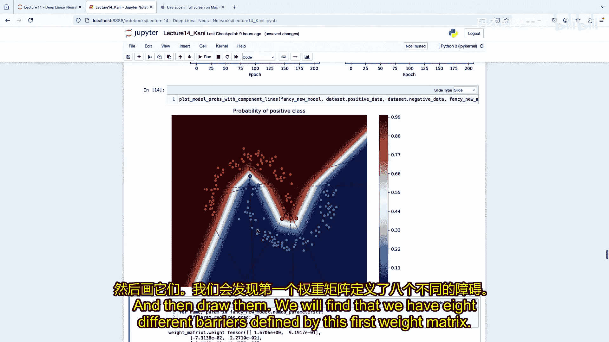

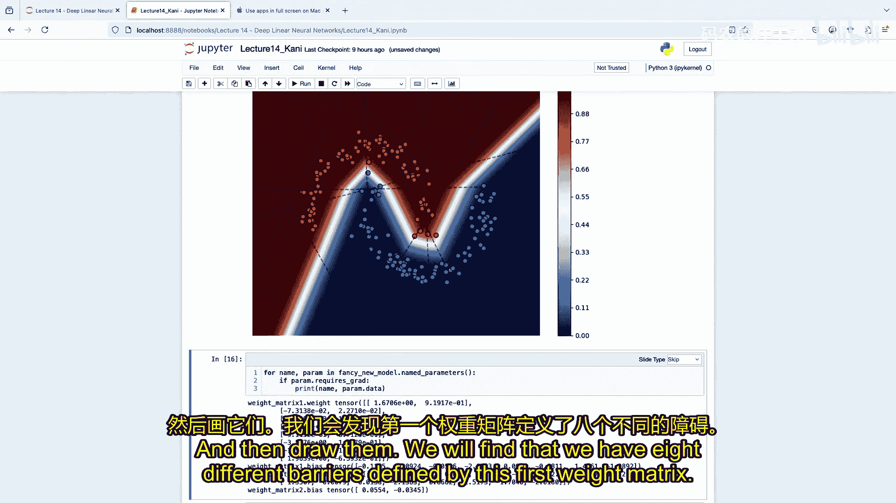

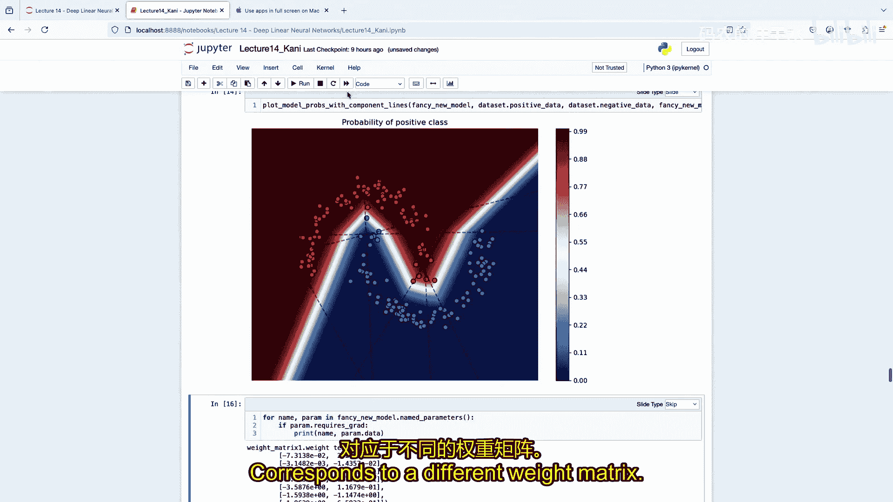

实际上，如果你分析这些单一的边界，例如，你可以看到这两条边界相交的点，就是总边界从向上弯曲变为向下弯曲的点；这些边界相交的点，就是总边界从向下弯曲变为向上弯曲的点。所以，如果你摆弄这个模型，你可以很容易地看到，第一层上的多个线性边界如何加总到第二层的一个非线性边界中。同样，你不一定只做两层，但思路是一样的。例如，如果你有三层，第二层会给你多个非线性边界，你可以有一个这样的边界，一个那样的边界。然后第三层会将所有这些非线性边界加总成一个新的非线性边界，依此类推。这就是你扩展模型的基本方式：你从一堆线性边界开始，得到一堆非线性边界，将这些非线性边界加总成一些更超级的非线性边界，然后将这些超级非线性边界加总成一组极其非线性的边界，等等。这就是深度神经网络的美妙之处，你可以有效地从多个线性函数构造出许多不同类型的非线性函数。

这与计算的许多不同方面有关。从线性的东西构建非线性的东西，这基本上是所有计算机图形学的前提。我们看到的每一张计算机图形，每一个图像，都只是一个三角形多边形。然后你把一大堆三角形放在一起，就得到了某个复杂的三维形状。这里也一样。你把一堆线性边界放在一起，得到一个复杂的非线性边界。你把一堆这样的边界放在一起，得到更复杂的东西，依此类推，一直下去。

这说得通吗？希望我已经解释清楚了。

---

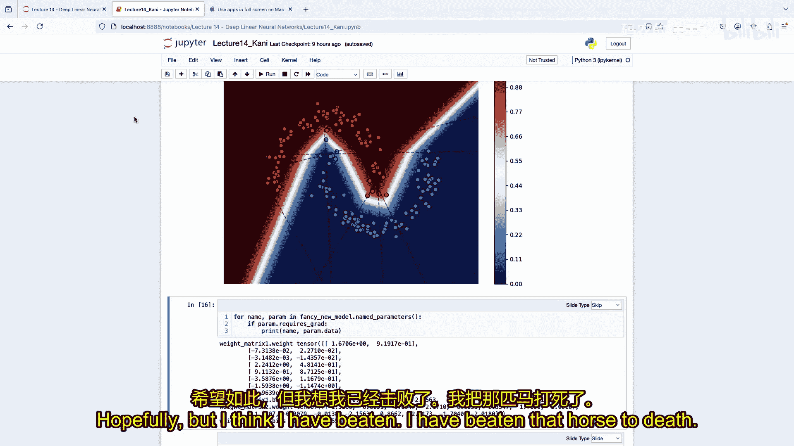

## 激活函数的选择

你可以使用任何你想要的激活函数。我尝试过这些激活函数中的大多数，它们在上面的模型代码中都工作得不错。我鼓励你尝试一下，只需将ReLU改为Sigmoid或任何你想要的，看看不同的激活函数会给你带来什么。

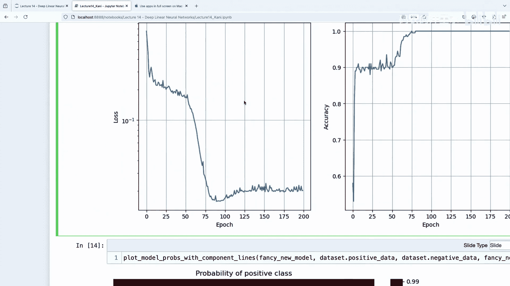

主要的一点是，激活函数是非线性的，而PyTorch提供给你的几乎所有激活函数都是非线性的。我不认为有一个定义的线性激活函数，因为你只需要把东西放在一起，但我可能错了。PyTorch给了你一大堆不同的非线性激活函数。如果你想试验代码，只需从网站下载。只需更改这一行，在第11行，将ReLU改为tanh或Sigmoid或其他。你可以看到它如何影响事物。它确实会影响模型，但它仍然会给你那种复杂的非线性边界。

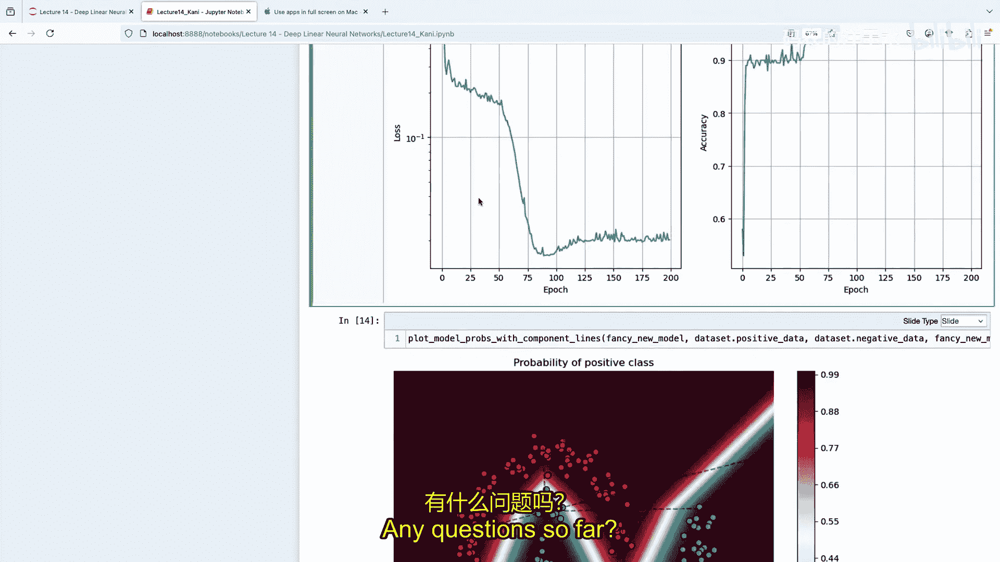

---

## 定义与架构

我们创建的模型被称为两层感知器。单个权重感知器简单来说就是其中一层。类似于上面显示的图表，感知器简单来说就是一个向量馈入另一个向量，然后通过某个非线性激活函数进行变换。这就是所谓的感知器。由非线性激活函数分隔的多个感知器的连接被称为多层感知器，原因显而易见。基本上，你有一堆线性边界，在这里输出一堆线性边界，你将一堆非线性边界输入到这里，得到一堆非线性边界输入到这里，依此类推。

重要的是，即使没有显示，每一层后面都跟着一个激活函数。如果它分隔了模型的输入和输出，则被称为隐藏层。在模型中，我们有一个输入层，它接收一堆输入；我们有一个输出层，它输出一些值，即输入属于类别K的概率；然后介于这两者之间的所有层都称为隐藏层，因为你没有直接看到或与它们交互。

每一层都有输入和输出维度。这基本上是模型架构的一个超参数。这非常重要，因为至少在你将看到的标准神经网络模型中，你必须定义的就是层的大小。你不能在事后动态定义层的大小。如果你允许计算机不仅改变矩阵内部的权重，还能改变矩阵本身的大小，你认为会发生什么？计算机会让矩阵尽可能大，因为为什么不呢？所以，有一些进化算法基本上允许你在进化过程中改变模型的结构。但通常你必须为模型大小提出一些约束。所以在这种情况下，我们考虑的简单神经网络模型中，你必须定义的唯一东西就是层的大小。当然，还有层的顺序和结构等。所以，你必须定义模型的架构。然后你可以将所有东西设置为从某个随机变量开始，计算机会尝试弄清楚是否一切都会工作。但层的大小和层之间的激活函数，你必须定义它们。

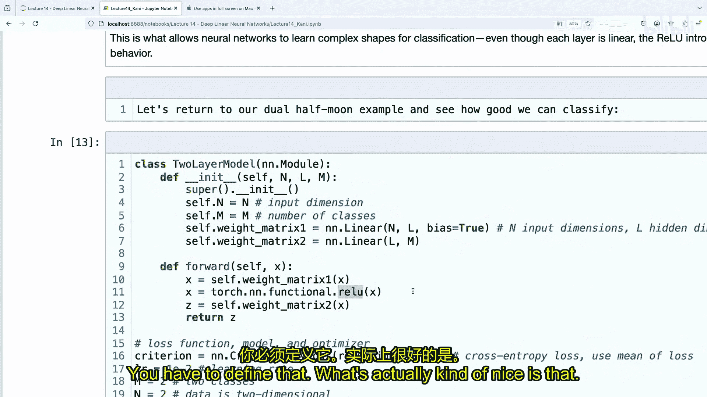

实际上，有点意思的是，在某些激活函数中，你有可以训练的参数。例如，在某些更复杂的激活中，优化参数可以稍微调整它们。但那是更复杂的优化。对于深度神经网络，你的工作基本上是确保定义系统架构。就是这样。

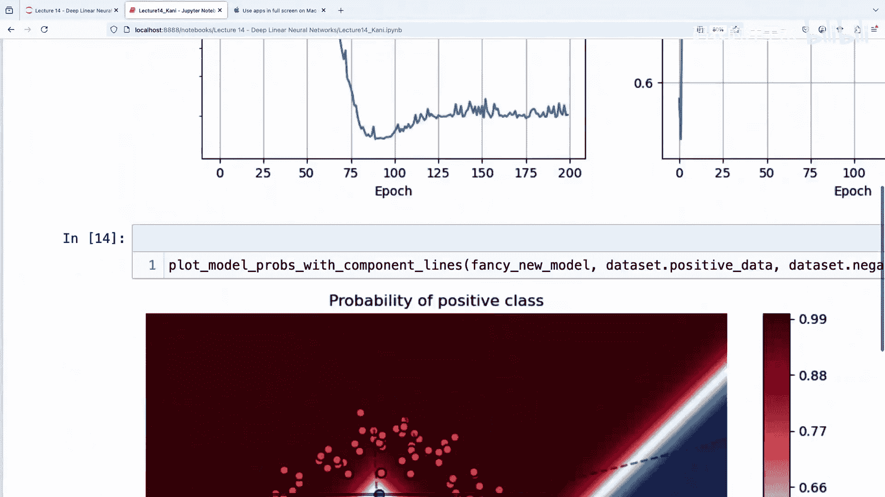

在这个例子中，我们定义了一个两层感知器模型。在这个例子中，这将被称为三层感知器模型，因为你有一到三层。通常，你不会在名称中包含输入层，因为输入层只是复制输入值，它并不真正做什么。所以在这种情况下，这是一个三层感知器。你可以继续到20层感知器，甚至100层，尽管可能收益递减。

---

## 实战：Fashion-MNIST数据集

多层感知器如此有用或如此好的一个原因是，之前我们有一个美丽但有点简单的分类数据集。还有更复杂的分类数据集。例如，除了MNIST数字数据集，还有一个经典的数据集是Fashion-MNIST数据集，它给你一个28x28像素的特定服装物品图像。你的工作基本上是将图像分类为裤子、连衣裙、凉鞋、衬衫、包等。28x28图像。很难相信曾经有一段时间，这对计算机来说实际上很难渲染。

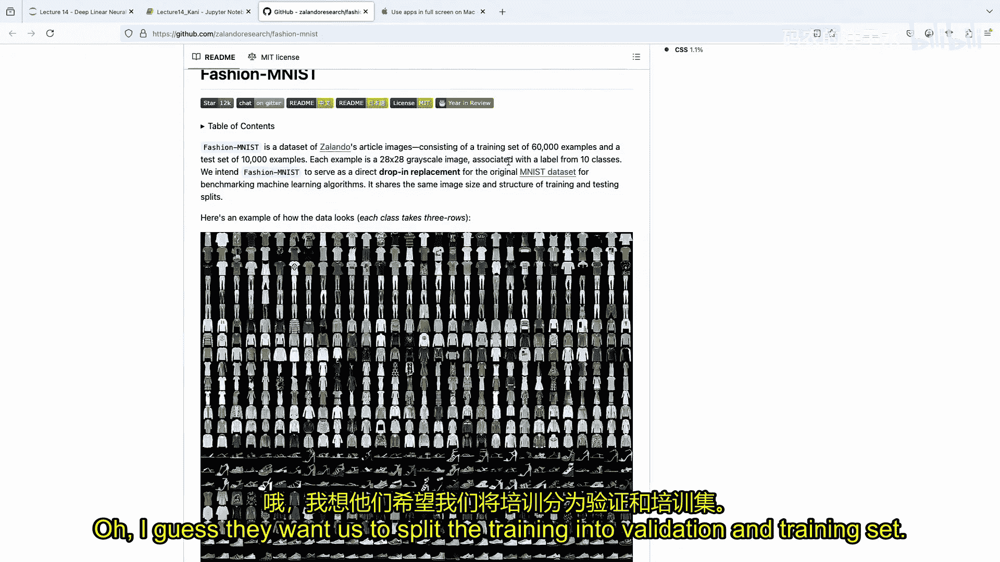

这是一个庞大的数据集。它有70,000个示例，他们没有定义特定的验证集，这没关系。这是所谓的MNIST数据集，来自国家标准与技术研究院。每个人都很熟悉MNIST数字数据集。这几乎是同样的东西，只是这是服装物品，图像稍微复杂一些。

但好的是，这是一个28x28的灰度服装物品图像。所以它是一个相对简单的数据集。我们可以简单地创建一个模型。在这个例子中，我们可以创建一个三层模型，或者一个两层模型。一个简单的两层模型。我们有一个输入维度，即28x28，这是数据集中的像素数。我们有一些隐藏层维度，还有一个输出维度。输出维度是类别数量。在Fashion-MNIST数据集的情况下，有10个类别：衬衫、鞋子、包、裤子、套头衫等。有28x28个输入，所以给你784个输入维度。然后有一些隐藏层维度。然后无论你想要你的隐藏层大小是多少。在这个例子中，我们将使我们的隐藏层大小为128。为什么？因为它似乎工作得很好，而且不是太大。

我们再次定义一个两层多层感知器模型，其中第一层从输入到隐藏层，即从输入维度到隐藏层的矩阵。然后我们有一些特定的激活函数，在这个代码中我们再次定义为ReLU，你可以来这里更改隐藏层的激活函数。然后我们有第二层，从隐藏层到输出。我们有10个输出类别，所以这就是为什么我们需要输出维度为10。隐藏层来自隐藏层，所以无论隐藏层的维度是多少，都必须是权重矩阵的第一个维度。

顺便说一下，这个矩阵对应于节点之间的权重。当我第一次学习时，这总是让我困惑：权重矩阵对应于节点之间的权重，而不是这些节点本身。这些节点本身是矩阵乘法的实际输出。

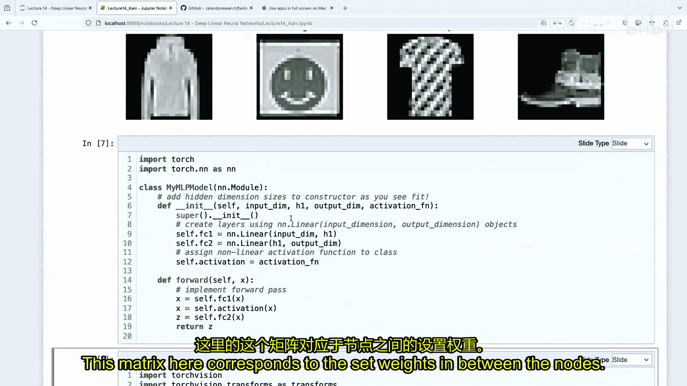

所以，一个简单的两层感知器。我们在这里没有做任何特别的事情。唯一另一件事是我们使用数据加载器来上传MNIST数据集，并且我们正在从TorchVision下载Fashion-MNIST数据集。如果你运行此代码，它会将Fashion-MNIST数据集下载到你的本地文件夹。这就是TorchVision的工作方式。你调用这个函数，它会向PyTorch服务器发送请求，然后你本地下载实际的Fashion-MNIST数据集。它不大，只有几兆字节。

简单的两层感知器。我们定义数据加载器以给我们批量的图像，所以我们在这里进行随机梯度下降。这是我们训练优化器的方式。同样，对于每个批次，我们将梯度归零。我们通过将批次输入模型来计算预测。然后我们通过对预测和Y批次的实际目标进行多类交叉熵损失来计算损失。然后我们计算损失反向传播，并进行优化器步骤。所有这些都是你以前见过的非常标准的代码。

如果我们运行这个，我们的损失会显著下降。损失从2左右开始，这相当高，最终在0.0015左右。然后我们的训练准确率从30.4%上升到几乎100%，我们的验证准确率也上升到80%以上。所以它工作得很好。多层感知器工作得很好。

但有一个小问题。对于Fashion-MNIST数据集，你有一个28x28像素大的图像。像素如此粗糙是因为你希望输入小，因为你只是想学习神经网络，还不想处理在GPU上训练。问题出现在当你需要处理更大的图像时。例如，如果你的图像是256x256，并且这一层的输出大小相同，那么需要多少权重？将需要大约40亿个权重。我不知道你们是否关注LLM，但小型LLM大约是这个数量级。最流行的小型LLM Llama 2有70亿个可训练参数。我可以向你保证，一个拥有40亿个参数的简单两层感知器，其用处远不如拥有70亿个参数的大型语言模型。

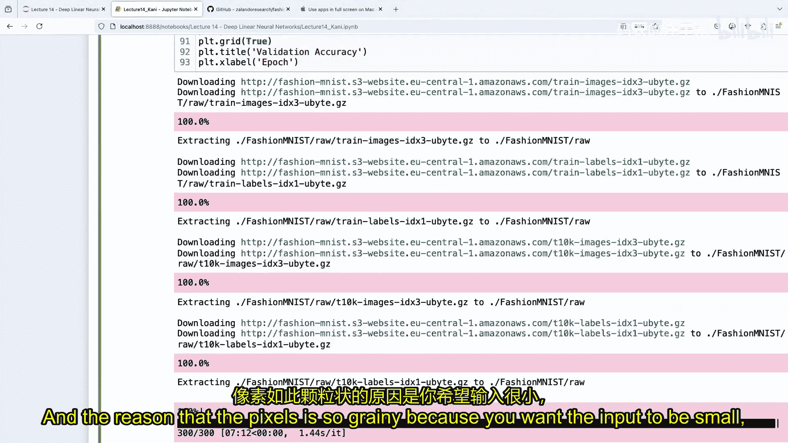

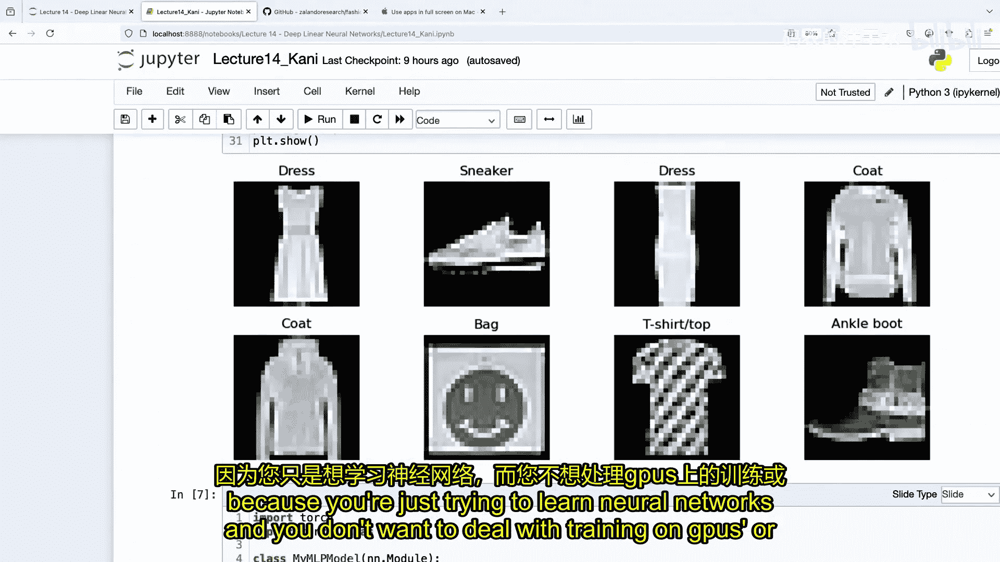

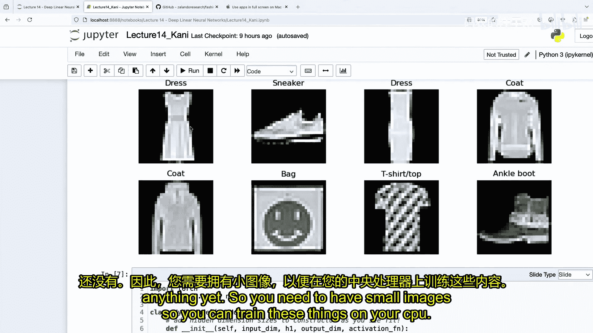

所以，这一切都说明，理论上，你可能只需拥有尽可能大的简单多层感知器就能解决任何问题。但存在限制。这就是为什么我们有算法和计算机科学。不是所有事情都能通过蛮力处理。这就是我们下次要讨论的内容。我们将讨论卷积神经网络，这是处理复杂数据、处理大数据输入的下一个新架构。

---

## 总结

本节课中，我们一起学习了多层感知器的核心概念。我们从逻辑回归的局限性出发，引入了非线性可分问题。通过构建多层网络并在层间使用非线性激活函数（如ReLU），我们能够组合多个线性边界以形成复杂的非线性决策边界。我们探讨了激活函数在打破网络线性、实现复杂函数逼近中的关键作用。最后，我们通过Fashion-MNIST数据集的实例，演示了如何在PyTorch中构建和训练一个简单的两层感知器，并取得了良好的分类效果。我们也指出了全连接网络在处理高维输入（如图像）时参数爆炸的问题，为下一课学习卷积神经网络做好了铺垫。