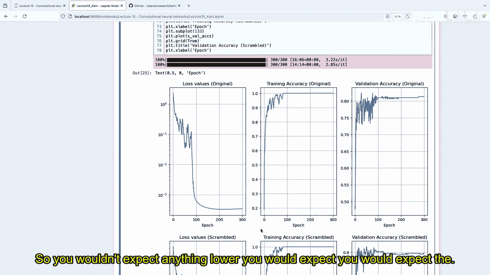
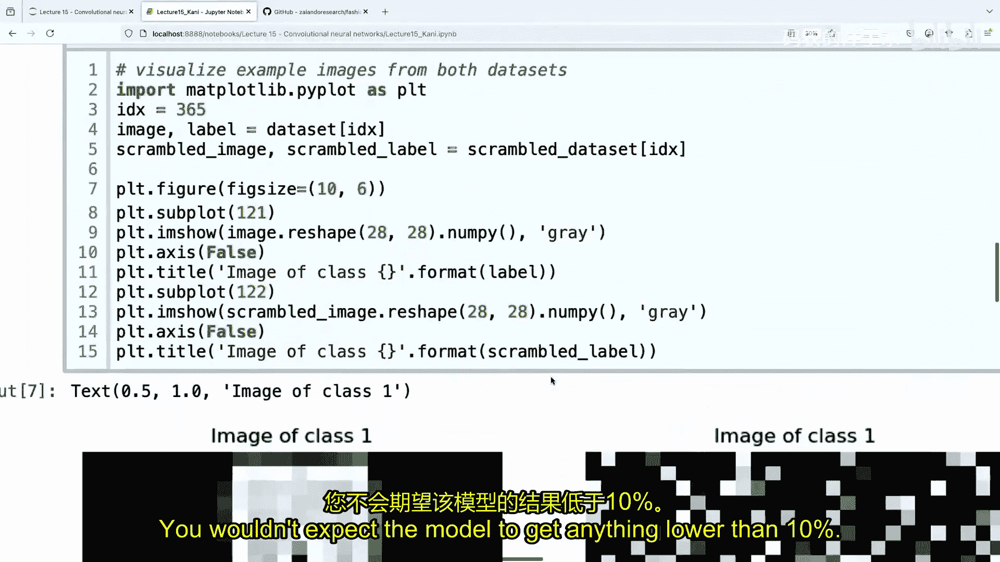
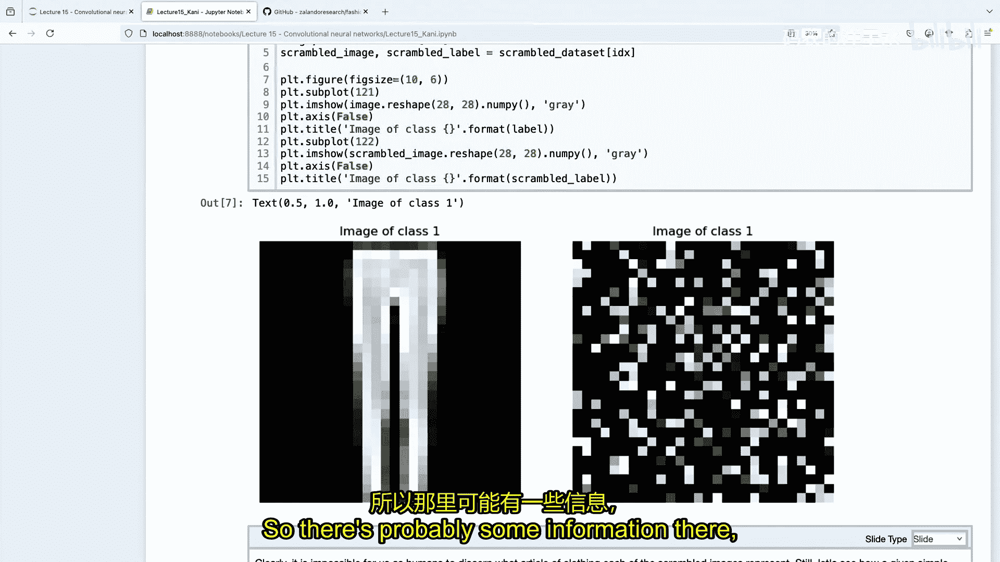
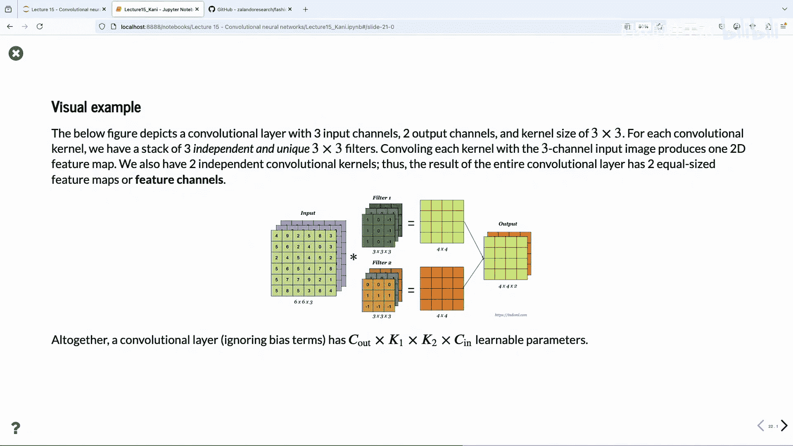

# 016：卷积神经网络 🧠

在本节课中，我们将要学习卷积神经网络。我们将从回顾多层感知机开始，然后深入探讨卷积层的工作原理、优势，以及它们如何利用数据的空间信息来构建更高效、更强大的模型。

## 多层感知机回顾

上一节我们介绍了多层感知机。本节中，我们来看看它的基本结构。

一个多层网络接收一个由实数组成的向量作为输入，并通过一系列 K 层进行处理。每一层都包含一个权重矩阵的乘法运算，并通常包含一个偏置项。

对于一个 K 层 MLP，其函数可以表示为：
`f(x) = σ_K(W_K * σ_{K-1}(W_{K-1} * ... σ_1(W_1 * x + b_1) ... + b_{K-1}) + b_K)`

其中，`σ` 代表激活函数，`W` 代表权重矩阵，`b` 代表偏置项。

每一层都需要通过一个非线性激活函数进行分隔。这是为了防止各层相互结合，最终退化为一个单一的线性函数。每个隐藏层的作用是将大小为 N 的输入转换为大小为 D 的输出。

网络的深度由层数定义，而宽度通常由最大的隐藏层大小定义。

多层网络的优势在于，它们能够组合线性边界来创建非线性边界，从而对复杂的数据集实现近乎完美的分类。例如，在 Fashion-MNIST 数据集上，多层感知机可以达到接近 100% 的训练准确率和约 80% 的验证准确率。

验证准确率低于训练准确率的原因是过拟合。网络在训练集上过度优化，导致其在未见过的验证集上泛化能力下降。

## 空间信息的缺失与问题





然而，传统的多层感知机存在一个关键问题：它缺乏空间感知能力。



当图像被输入网络时，它首先被展平成一个一维向量。网络中的每个隐藏神经元都连接到输入图像中的每一个像素。这意味着，网络并不认为相邻的像素在空间上更相关。

为了说明这一点，我们可以对图像进行“置乱”操作。即，对图像的所有像素应用一个固定的随机排列。对人类而言，置乱后的图像无法识别。但对多层感知机而言，它仍然能够以相似的准确率（训练集近 100%，验证集约 80%）学习并分类这些图像。这种特性被称为“排列不变性”。

排列不变性在某些场景下（如词袋模型）有用，但它也暗示网络可能在使用一种低效的“蛮力”方法，而非理解图像的本质结构。

更严重的问题是，多层感知机对图像的绝对位置非常敏感。如果我们仅仅将图像整体平移几个像素（例如向右平移两像素），然后用原始模型进行测试，其准确率会从 80% 骤降至 39%。这表明模型过度依赖像素的绝对位置，而非物体的相对结构和形状。

此外，随着输入图像尺寸增大，全连接层的参数量会爆炸式增长。对于一个 256x256 的图像，输入层到第一个隐藏层的参数量可能达到数十亿，这是不切实际的。

因此，我们需要一种新的网络结构，它能够：
1.  利用像素间的空间关系。
2.  使参数量不随输入尺寸剧烈增长。
3.  对图像的位置变化具有更好的鲁棒性。

## 卷积神经网络简介

卷积神经网络正是为解决上述问题而设计的。它通过使用卷积层来利用空间信息，并有效控制参数量。

卷积层的基本思想是：不再让每个神经元连接整个输入，而是让它只连接输入的一个局部区域（例如一个 3x3 的方块）。更重要的是，在不同局部区域上应用的“过滤器”或“卷积核”是共享权重的。

这意味着，网络不是在寻找“某个特定位置的像素是白色”，而是在整个图像中扫描，寻找“是否存在某种特定的局部模式”（如边缘、角点）。这极大地减少了需要训练的参数数量，并赋予了模型平移不变性的基础。

## 卷积操作详解

卷积是一种数学运算。在离散的二维情况下（如图像处理），卷积操作可以理解为将一个较小的滤波器（卷积核）在较大的输入图像上滑动。

在每一步，计算滤波器与当前图像局部区域的逐元素乘积之和，并将结果输出到特征图的对应位置。

以下是一个简单的 1D 卷积示例：
-   输入信号 `x = [2, 1, -3, 0, 4]`
-   卷积核 `h = [1, 0, -1]`
-   首先将卷积核反转：`h_rev = [-1, 0, 1]`
-   然后滑动并计算：
    -   第一步：`[-1, 0, 1]` 与 `[2]` 对齐 -> `2 * 1 = 2` (实际上，更常见的做法是直接滑动，不反转，这在互相关中更常见，深度学习框架通常使用互相关并称之为卷积)。
    -   更常见的计算（互相关）：
        -   位置1: `[1,0,-1]` 与 `[2,1,-3]` -> `2*1 + 1*0 + (-3)*(-1) = 2 + 0 + 3 = 5`
        -   位置2: `[1,0,-1]` 与 `[1,-3,0]` -> `1*1 + (-3)*0 + 0*(-1) = 1`
        -   ... 以此类推。

在深度学习中，我们通常直接使用这种“滑动窗口点积”的操作，并将其称为卷积。

## CNN 的关键组件与结构

一个典型的卷积神经网络由以下几种层构成：

**卷积层**
这是核心组件。它使用一组可学习的滤波器来扫描输入，提取特征。关键参数包括：
-   `in_channels`：输入通道数（如 RGB 图像为 3）。
-   `out_channels`：输出通道数（即滤波器的数量）。
-   `kernel_size`：滤波器大小（如 3x3）。
-   `stride`：滑动步长。
-   `padding`：在输入边缘填充零的层数，用于控制输出尺寸。

**激活函数层**
与 MLP 类似，在卷积层之后通常需要非线性激活函数（如 ReLU），以引入非线性，使网络能够学习复杂模式。

**池化层**
用于降低特征图的空间尺寸，减少计算量并增强特征的空间不变性。常见类型有：
-   **最大池化**：取局部区域内的最大值。
-   **平均池化**：取局部区域内的平均值。

**全连接层**
在网络的末端，将提取的高级特征映射到最终的输出类别。通常在池化后使用。

**全局池化层**
一种特殊的池化，它将整个特征图（每个通道）池化为一个单一的值（如取全局平均值或最大值）。这常用于将任意尺寸的特征图转换为固定长度的向量，以便输入全连接层。

一个常见的 CNN 结构示例如下：
`输入图像 -> [Conv2d -> ReLU] x2 -> MaxPool2d -> [Conv2d -> ReLU] x2 -> MaxPool2d -> Conv2d -> GlobalAvgPool2d -> Linear -> 输出`

## CNN 实战：Fashion-MNIST

让我们将 CNN 应用于 Fashion-MNIST 数据集，并与之前的 MLP 进行对比。

首先，我们定义一个简单的 CNN 模型。与 MLP 不同，我们不再需要将输入图像展平。

```python
import torch.nn as nn

class SimpleCNN(nn.Module):
    def __init__(self, num_classes=10):
        super(SimpleCNN, self).__init__()
        self.conv1 = nn.Conv2d(in_channels=1, out_channels=16, kernel_size=3, padding=1)
        self.conv2 = nn.Conv2d(in_channels=16, out_channels=32, kernel_size=3, padding=1)
        self.pool = nn.MaxPool2d(kernel_size=2, stride=2)
        self.conv3 = nn.Conv2d(in_channels=32, out_channels=64, kernel_size=3, padding=1)
        self.global_pool = nn.AdaptiveAvgPool2d((1, 1))
        self.fc = nn.Linear(64, num_classes)
        self.relu = nn.ReLU()

    def forward(self, x):
        x = self.relu(self.conv1(x))
        x = self.pool(self.relu(self.conv2(x)))
        x = self.relu(self.conv3(x))
        x = self.global_pool(x)
        x = x.view(x.size(0), -1)
        x = self.fc(x)
        return x
```

使用与之前相同的训练循环，我们训练这个 CNN 模型。结果如下：
-   **训练准确率**：接近 100%。
-   **验证准确率**：大约 78%。

这个 CNN 的参数量约为 60,000，比之前参数量约 100,000 的 MLP 更少，但准确率仅略低 2-3%。这体现了 CNN 的参数效率。

更重要的是，当我们测试 CNN 模型对平移图像的鲁棒性时（使用相同的平移 2 像素的数据集），其准确率从 78% 降至 75%，下降幅度远小于 MLP 的 80% -> 39%。这表明 CNN 通过关注局部特征而非绝对位置，获得了更好的泛化能力。

## 总结

本节课中我们一起学习了卷积神经网络。

我们从多层感知机的局限性出发，认识到其缺乏空间感知、参数量大和对平移敏感的问题。卷积神经网络通过引入卷积层，利用局部连接和权值共享，高效地提取图像的空间特征。

我们详细探讨了卷积操作、CNN 的关键组件（卷积层、池化层、全连接层等），并通过实战在 Fashion-MNIST 数据集上验证了 CNN 的有效性。结果表明，CNN 能以更少的参数达到相近的精度，并且对图像的平移变化具有更强的鲁棒性。



CNN 是深度学习在计算机视觉领域取得突破的基石，理解其原理是进一步学习更复杂模型的关键。