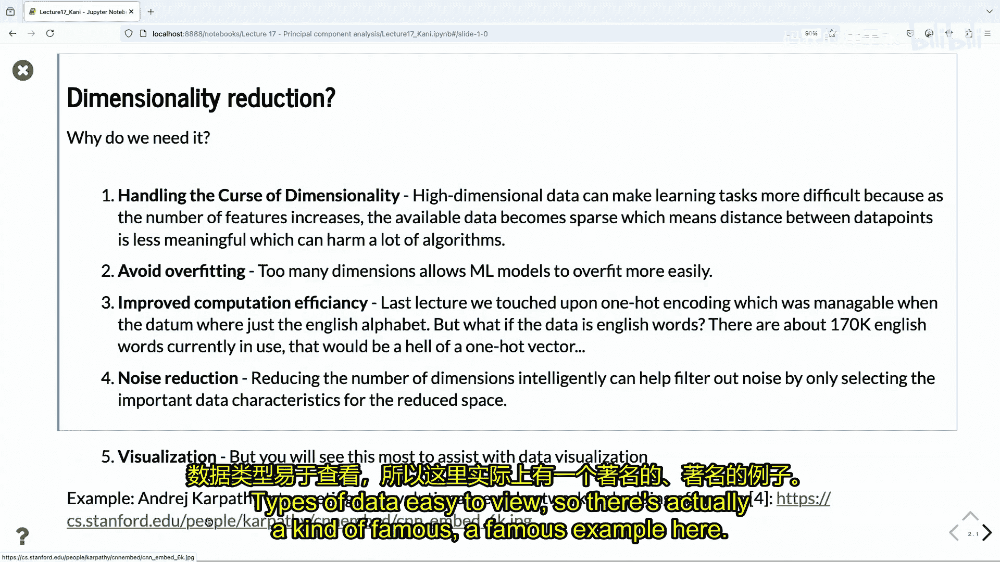
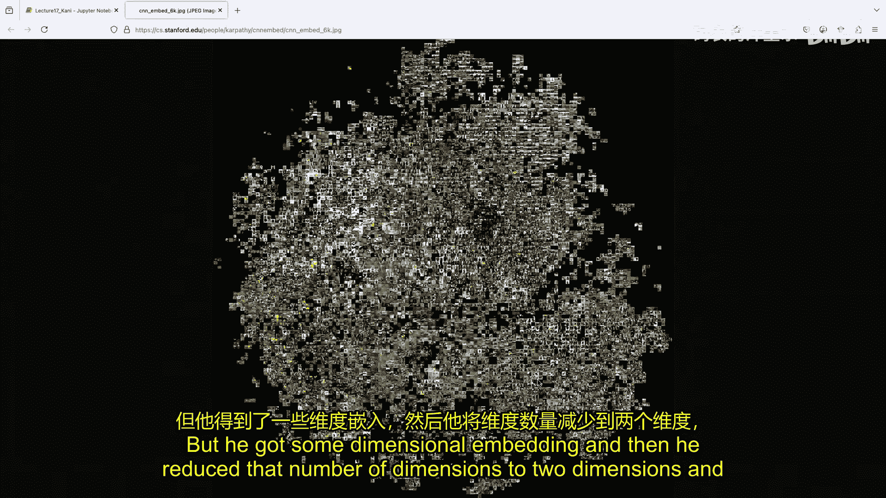
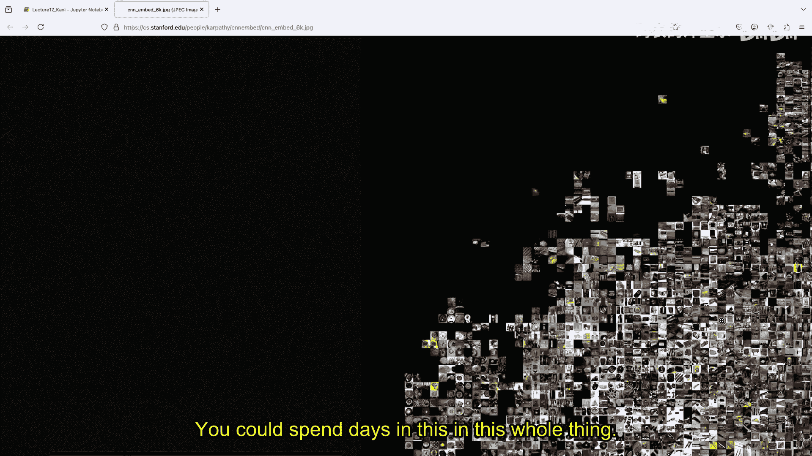
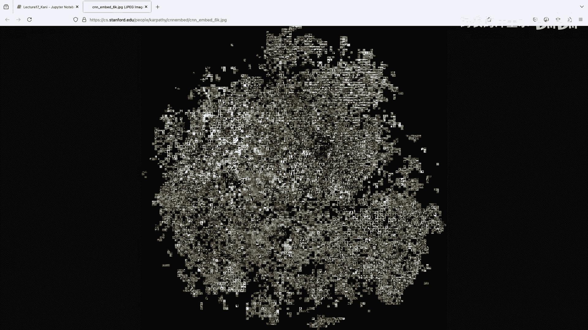

# 018：主成分分析

在本节课中，我们将要学习一种重要的无监督机器学习技术——主成分分析。我们将探讨其动机、核心概念、数学推导以及实际应用。

## 概述

主成分分析是一种用于数据降维的技术。其核心目标是在减少数据维度的同时，尽可能多地保留原始数据中的关键信息。这对于处理高维数据、避免过拟合、提高计算效率以及数据可视化都非常有用。

## 动机：为什么需要降维？



降维的主要动机源于“维度灾难”。当数据的特征数量过多时，可用数据会变得稀疏，数据点之间的距离变得不那么有意义，这可能损害许多算法的性能。此外，降维还可以帮助避免过拟合、提高计算效率、减少噪声，并方便数据可视化。






例如，在可视化高维数据时，我们通常希望将其投影到二维平面上，以便直观地观察数据点之间的关系和聚类情况。



## 核心概念：投影与方差最大化

上一节我们介绍了降维的动机，本节中我们来看看如何实现降维。核心思想是找到一个低维子空间（例如一条线或一个平面），将高维数据点投影到这个子空间上。

关键在于如何选择这个子空间。一个直观的标准是：**投影后的数据应尽可能分散**，即投影点的方差应最大化。方差越大，意味着数据在低维空间中保留的信息越多。

假设我们有一个D维的数据点，我们希望将其投影到一个M维的空间（M < D）。我们需要M个投影向量来定义这个新空间。每个投影向量都是D维的，并且我们通常假设它们是单位长度且彼此正交的。

数据点 **x** 投影到新空间后得到的点 **z**，可以通过以下公式计算：
**z = W^T * x**
其中，**W** 是一个 D x M 的矩阵，其列向量就是我们的投影向量。

## 数学推导：寻找最佳投影向量

上一节我们明确了目标是最大化投影数据的方差。本节中我们将通过数学推导找到实现这一目标的投影向量。

首先，假设数据已经进行了中心化处理（均值为0）。那么，投影数据的方差可以表示为：
**方差 = (1/N) * Σ (w_i^T * x)^2**
其中，**w_i** 是第i个投影向量。

经过推导（利用 **x * x^T** 是数据的协方差矩阵 **Σ**），我们可以得到投影到向量 **w_i** 上的数据的方差为：
**方差_i = w_i^T * Σ * w_i**

我们的目标是最大化这个方差，同时约束 **w_i** 是单位向量（即 **w_i^T * w_i = 1**）。这是一个带约束的优化问题，可以使用拉格朗日乘数法求解。

构造拉格朗日函数：
**L(w_i, λ) = w_i^T * Σ * w_i - λ (w_i^T * w_i - 1)**

对 **w_i** 求导并令其为零，我们得到：
**Σ * w_i = λ * w_i**

这正是特征值和特征向量的定义式！这意味着，**能使投影方差最大化的投影向量 **w_i**，正是数据协方差矩阵 **Σ** 的特征向量**。而对应的特征值 **λ** 就是投影后的方差值。

因此，**主成分分析的核心步骤就是计算数据协方差矩阵的特征值和特征向量，并选择特征值最大的前M个特征向量作为投影方向**。这些特征向量被称为“主成分”。

## PCA 实战步骤

基于上述推导，我们可以总结出执行PCA的清晰步骤：

1.  **数据标准化**：将每个特征的均值调整为0。
2.  **计算协方差矩阵**：计算标准化后数据的协方差矩阵 **Σ**。
3.  **特征分解**：计算协方差矩阵 **Σ** 的特征值和特征向量。
4.  **选择主成分**：将特征值从大到小排序，选择前M个最大的特征值对应的特征向量。
5.  **投影数据**：使用选定的特征向量构成投影矩阵 **W**，将原始数据 **X** 投影到新空间得到 **Z = X * W**。

在实际应用中，我们可以使用PyTorch等库轻松实现PCA。例如，`torch.pca_lowrank` 函数可以方便地完成上述步骤。

以下是使用PyTorch进行PCA降维的示例代码框架：
```python
import torch
# 1. 假设 data 是一个 [N, D] 的Tensor，N是样本数，D是特征数
# 2. 中心化数据
data_centered = data - data.mean(dim=0)
# 3. 使用PyTorch进行PCA
U, S, V = torch.pca_lowrank(data_centered, q=2) # q指定要保留的主成分数量
# 4. V 的列就是主成分（特征向量）
principal_components = V[:, :2]
# 5. 投影数据
projected_data = torch.matmul(data_centered, principal_components)
```

## PCA 的应用实例

上一节我们学习了PCA的计算步骤，本节中我们来看看它的实际应用效果。

一个经典的应用是数据可视化。例如，对MNIST手写数字数据集（784维）进行PCA，将其降至2维后绘图，可以发现数字类别相近的样本点在二维平面上也倾向于聚集在一起。

另一个有趣的应用是观察主成分本身的含义。如果我们对同一类数字（例如所有的“5”）的图片进行PCA，并查看前几个主成分（特征向量），将其还原为图像形状，会发现：
*   第一个主成分（最大特征值对应）看起来像一个标准的、清晰的“5”。
*   后续的主成分可能分别代表了“5”的常见书写变体，如不同的倾斜角度、笔画粗细等。

这直观地展示了PCA在寻找数据中最主要变化模式方面的能力。

## 总结


本节课中我们一起学习了主成分分析。我们从降维的动机出发，理解了通过最大化投影方差来保留数据核心信息的理念。我们推导出，实现这一目标的关键在于找到数据协方差矩阵的特征向量。最后，我们介绍了PCA的标准步骤、代码实现以及其在数据可视化和特征理解方面的应用。PCA是一种强大而基础的工具，是理解高维数据和进行特征提取的入门关键技术。