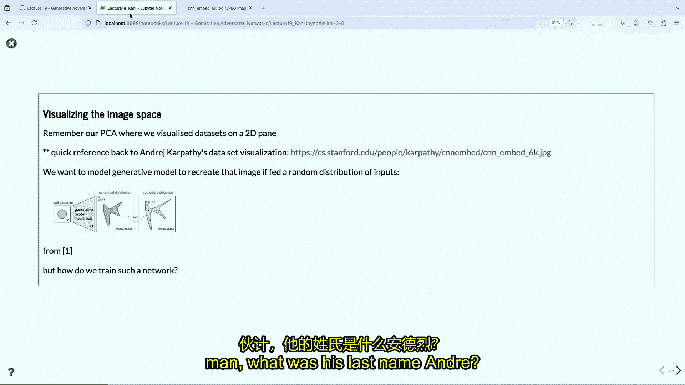
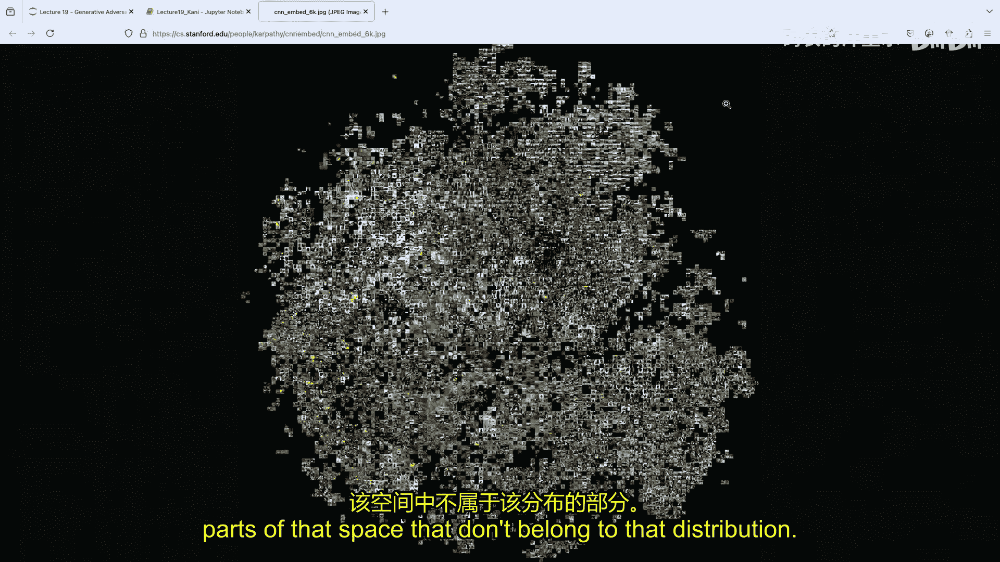
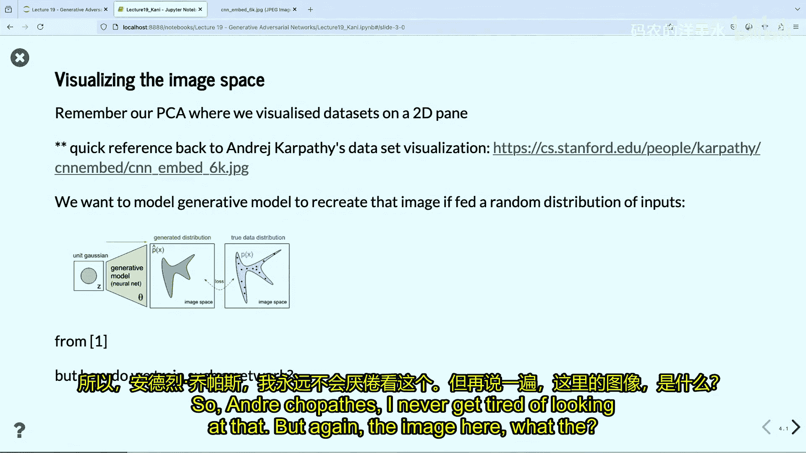
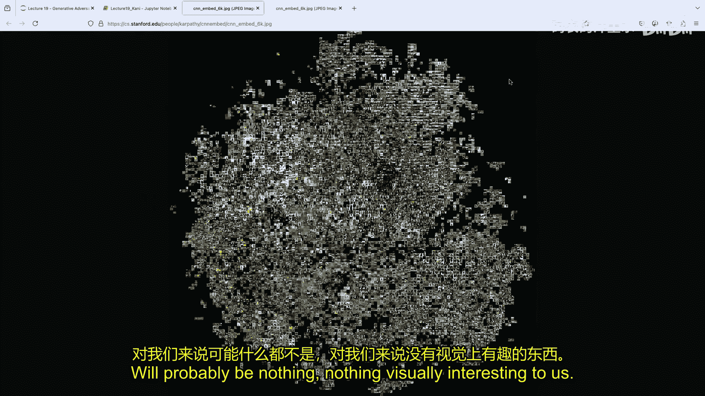
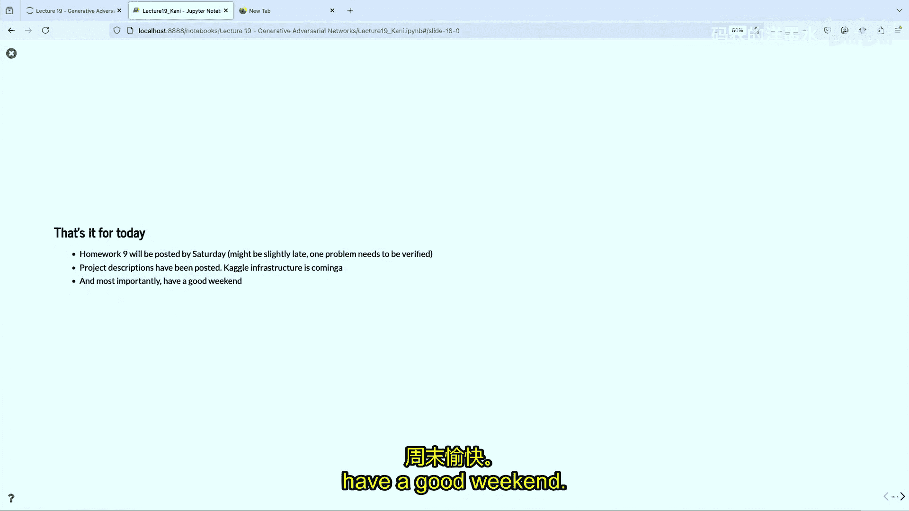

# 019：生成对抗网络 🎭

在本节课中，我们将要学习一种强大的无监督学习模型——生成对抗网络。我们将探讨其背后的理论、实现方法以及多种应用场景。

上一节我们介绍了主成分分析、K均值聚类和高斯混合模型等无监督学习方法。本节中，我们来看看另一种重要的无监督学习模型：生成对抗网络。

## 什么是生成对抗网络？

生成对抗网络是另一种无监督学习的例子。我们之前讨论的分类属于监督学习，我们有数据和标签，希望模型预测标签。而像PCA、K均值聚类这类任务，我们只有一堆数据，希望以某种方式利用这些数据。今天，我们将在此基础上，利用无监督方法做一些更有趣的事情。

我们将了解生成对抗网络背后的理论，学习其实现方法，并探讨GAN的多种用途。

## 无监督学习任务回顾

以下是三种主要的无监督学习任务：

*   **聚类**：将数据分割成不同的组，而不需要实际的标签。
*   **数据可视化**：这主要是为了我们人类自己。我们需要一种方式来可视化整个数据集。当数据集有784个维度时，我们无法真正可视化100个维度。因此，我们需要将数据压缩并组织成更少的维度。
*   **压缩**：我们有一个包含784个特征（像素）的数据集。我们真的需要那么多特征来表示手写数字吗？并不需要。压缩背后的理念是，你可以将大量数据压缩到更小的空间中，然后解压缩并恢复大部分数据，而不会丢失太多信息。

## 生成任务：无监督学习的新领域

我们尚未讨论的无监督任务是**生成**。可以说，这是我们使用机器学习模型最重要的用途之一。像ChatGPT、Gemini等模型都是生成模型。它们能生成从未见过的新数据。

例如，你可以给模型一张EE大楼正面的图片，并给出提示：“将其风格改为《星夜》”。然后模型会根据《星夜》的风格重新生成那张图片。这就是生成的例子。我们创建了一个新的数据片段，我们希望这个新数据片段具有与我们从中获得灵感的其他数据集（即《星夜》这幅画）相同的特征。

但问题在于，我们并没有一张EE大楼的《星夜》风格图片。那么，机器如何学习生成一个从未出现过的新数据片段呢？这不是监督学习，因为在监督学习中，我们需要所有《星夜》风格的图片来训练模型。我们无法做到这一点，因为可能的输入空间是无限的。因此，我们无法以经典的监督方式训练这种生成模型。

## 生成模型与隐式生成模型

生成模型有很多种。一类常见的生成模型是**隐式生成模型**。它基本上定义了一个概率分布。

你从一个固定的采样分布开始采样，得到一个**代码向量**。然后，生成器网络使用这个代码向量，并通过一个可微函数将其映射到你的数据空间中的一个数据片段。

整个想法是，你有一个目标分布，即真实的数据分布。生成模型试图创建图像，如果你收集足够多的生成图像，它们将构成目标分布。它不会完美，但希望足够接近。

代码向量的作用是：网络本质上是确定性的。为了让它输出各种图像，我们只需输入一堆随机值。这类似于生成随机数：计算机首先获得一个种子，然后通过一系列混沌函数来获得一个输出随机值。这里，我们不是生成随机数，而是试图生成随机图像，并且希望这些图像符合我们之前见过的图像分布。

## 训练生成模型的挑战

问题在于，如何训练这样的网络？如果我们尝试直接训练，例如，构建一个巨大的网络，输入随机数，然后计算输出与数据集中某个图像之间的损失，这种方法效果通常不好。直接训练方法泛化能力差。

更大的问题是，我们想要一种方式来奖励模型生成了看起来属于新数据集的新图像，并惩罚模型生成了明显不属于原始图像空间的图像。那么，我们该怎么做呢？

我们需要区分好的图像和坏的图像。因此，我们不仅要有生成模型，还要训练另一个模型。这个模型接收生成器生成的任何内容，并进行**判别**，试图猜测这张图像是真实的（来自我们感兴趣的实际数据）还是生成的（完全虚构的）。

这个架构被称为**判别器**。我们有一个生成器，它从一些随机输入生成新图像。理想情况下，这个新图像看起来属于原始数据集。为了测试这个图像是否属于原始数据，我们训练另一个模型。这个模型的唯一任务是：如果我得到这张图像，我应该输出“假”（图像不真实）；如果我得到来自实际数据的图像，我应该输出“真”（图像真实）。

## 对抗性训练与损失函数

那么，我们如何知道模型做得好不好呢？如果生成器做得非常好，那么判别器的工作就会变得困难，表现会变差。如果生成器做得很差，而判别器非常好，那么判别器会表现得很好，但生成器则很差。因此，两者之间存在一种“对抗”关系。一个模型的目标是欺骗它的伙伴，而另一个模型的目标是发现它的伙伴何时在撒谎。这是相互矛盾的目标。

我们通过**损失函数**来制定模型的表现好坏。让我们建立一些符号：

*   我们将生成器表示为 **G**。它接收一个随机代码向量 **z**，并具有一些参数 **θ**。生成器输出一个特定的数据片段（例如，一个28x28的向量，784个介于0和1之间的值）。
*   我们将判别器模型表示为 **D**，它具有参数 **w**。
*   我们的判别器模型输出一个介于0和1之间的值，表示它认为图像是真实的置信度。如果图像是原始数据集 **X** 的一部分，它应该输出1；如果不是，则输出0。

对于判别器的损失函数，我们希望：
*   如果图像是真实的（来自目标数据集），我们希望通过判别器，并希望它输出1。
*   如果图像是假的（来自生成器），我们希望它输出0。

为了避免梯度消失（饱和）问题（类似于我们在Sigmoid函数中遇到的问题），我们对损失函数进行了调整，使其更类似于二元交叉熵损失。最终，我们得到了一个**极小极大**公式。

基本上，你有一个特定的损失函数，你试图修改架构的某些部分（参数 **w**）以最小化这个损失函数，同时修改其他部分（参数 **θ**）以最大化这个损失函数。所以你有一个二分法：生成器想要“搞砸”判别器，因为它希望判别器表现不佳；判别器则希望保持生成器的诚实，希望它努力生成即使我们（在不知情的情况下）也会相信属于数据集的东西。

## 实战示例：生成MNIST手写数字

让我们通过一个具体的例子来讨论。我们最喜欢的激励数据是MNIST数据集。假设我们想要生成看起来像属于MNIST数据集的假图像。MNIST数据集是手写数字的集合。这是一个有标签的数据集，但我们将忽略标签。我们只想创建一个生成器网络来生成手写数字。

我们该怎么做呢？和之前一样，我们有一个生成器。生成器接收一些随机噪声作为控制向量，生成一张假图像。这张假图像被送给判别器，由判别器判断真假。我们还会给判别器一些真实图像，让它判断是否为真。

在代码中，我们需要两个模型：一个生成器和一个判别器。为了简单起见，我们使用简单的线性层（实际上，对于图像，卷积层可能效果更好，但MNIST足够简单，线性层也能工作）。

生成器从一个100维的随机输入开始，通过几个线性层，最终输出一个展平的28x28图像。判别器同样简单：它接收一个28x28的图像，通过几个线性层，最终输出一个单一特征，并通过Sigmoid函数，输出一个介于0和1之间的值，表示图像为真的置信度。

## 训练过程

我们如何训练它们呢？我们首先训练判别器，然后训练生成器。将它们一起训练会产生不理想的结果。

训练判别器时，我们给它真实的图像（希望它输出1）和生成的图像（希望它输出0）。对于生成的图像，我们需要使用 `.detach()` 来分离它们，以防止梯度传播到生成器参数中。

训练生成器时，我们生成一些随机图像，将它们输入到判别器中，并希望判别器输出1（即被欺骗）。计算损失，然后反向传播以优化生成器。

在训练过程中，判别器的损失通常会徘徊在0.5左右，这是因为对抗性：如果生成器变得更好，判别器也必须变得更好，反之亦然。你最终会得到一个判别器，它能正确猜出一些假图像，也会错误地猜出一些假图像。这正是你想要的。

随着训练的进行，生成器生成的图像会从噪声逐渐变得清晰，最终能够生成非常逼真的手写数字。

## GAN的发展与应用

自2014年那篇开创性论文以来，GAN已经得到了极大的发展。训练高分辨率图像的GAN时，一种有效的方法是**渐进式增长**：从一个生成低分辨率粗糙图像的小模型开始训练，然后逐步增加模型大小和图像分辨率。

**CycleGAN** 是另一个重要进展，用于风格迁移。它不仅有一个将图像转换为目标风格的生成器，还有另一个生成器将转换后的图像恢复回原始图像。这确保了风格转换过程中内容信息得以保留。

**StackGAN** 结合了上述思想，可以从文本描述生成图像。它采用多阶段生成和判别过程，首先生成低分辨率草图，然后逐步生成高分辨率图像。

GAN有许多不同的用途，从图像生成、风格迁移到文本生成图像等。

## 使用GPU加速训练

随着模型变得越来越复杂，在CPU上训练效率很低。使用GPU训练非常简单：首先检查是否有可用的GPU，然后将模型和数据移动到GPU上，其余代码保持不变。这可以极大地加快训练速度。

## 总结

本节课中，我们一起学习了生成对抗网络。我们了解了GAN作为一种无监督生成模型的基本原理，包括生成器和判别器的对抗性训练思想。我们探讨了GAN的损失函数（极小极大公式）以及训练中的挑战（如梯度饱和）。通过MNIST手写数字生成的实战示例，我们学习了GAN的基本实现和训练流程。最后，我们简要介绍了GAN的进阶发展（如渐进式增长、CycleGAN）和广泛应用。GAN是生成模型领域的一个重要基石，为图像、文本等多种数据的创造提供了强大工具。