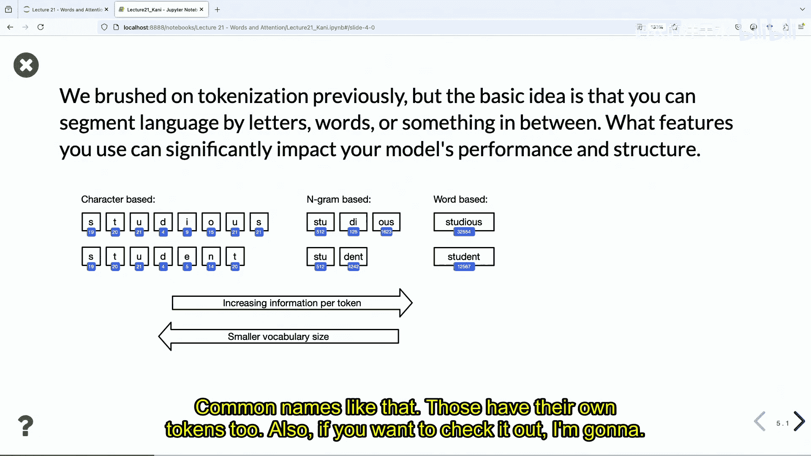

# 021：词汇与注意力机制 🧠

在本节课中，我们将学习现代大型语言模型（如ChatGPT）的核心基础——Transformer模型。我们将从循环神经网络（RNN）的局限性讲起，逐步深入到Transformer的各个组成部分，包括词汇编码、位置编码以及核心的注意力机制。

上一节我们讨论了循环神经网络在文本生成等任务中的应用。本节中，我们来看看RNN存在的一些问题，并引出更强大的Transformer模型。

## RNN的局限性

RNN在处理序列数据时存在几个关键问题：
1.  **计算速度慢**：RNN是顺序处理的，无法充分利用现代硬件的并行计算能力。
2.  **梯度消失/爆炸问题**：在深度网络中，反向传播时梯度会随着层数的增加而指数级地减小（消失）或增大（爆炸），这使得模型难以训练。
3.  **缺乏注意力机制**：RNN一次只处理一个词，难以捕捉长距离词与词之间的关系。例如，在句子“The mischievous dog, who was also red and had a smush face”中，形容词“mischievous”和“red”都修饰名词“dog”，但它们可能出现在名词的前后不同位置，RNN难以有效建立这种远距离联系。

## Transformer模型简介

2017年，Vaswani等人在论文《Attention Is All You Need》中提出了Transformer模型。它的核心创新在于**注意力机制**，允许模型在处理某个词时，同时关注输入序列中的所有其他词，从而更好地理解上下文关系。

Transformer模型主要由编码器（Encoder）和解码器（Decoder）组成。接下来，我们将一步步拆解其工作原理。

## 第一步：输入嵌入（Input Embedding）

机器只能处理数字，因此我们需要将文本符号（单词、字符等）转换为数字向量。这个过程称为**词元化（Tokenization）**。




以下是几种常见的词元化方法：
*   **基于字符**：将每个字符映射为一个数字。例如，“student”被编码为 `[19, 20, 21, 4, 5, 14, 20]`。优点是词汇表小，但每个词元信息量少。
*   **基于单词**：将每个单词映射为一个数字。例如，“student”对应数字3232554。优点是每个词元信息丰富，但词汇表可能非常庞大。
*   **基于子词（N-gram）**：折中的方法。将常见的字符组合（如前缀、后缀、常见单词）作为词元。例如，“student”可能被拆分为“stu”、“dent”。现代大模型（如GPT）通常采用这种方式，词汇表大小约在10万到20万之间。

词元化后，我们得到一系列数字ID。但这些ID本身不包含语义信息（例如，“猫”和“狗”在数字上并不接近）。因此，我们需要**嵌入（Embedding）**。

嵌入是一个可训练的矩阵 `E`，其大小为 `[词汇表大小, 模型维度]`。例如，模型维度为512，词汇表大小为10万，则 `E` 的形状为 `[100000, 512]`。每个词元ID对应这个矩阵中的一列（一个512维的向量）。在训练过程中，模型会调整这个矩阵，使得语义相近的词（如“猫”和“狗”）的嵌入向量在空间中也更接近。

**公式**：`embedding_vector = E[:, token_id]`

## 第二步：位置编码（Positional Encoding）

Transformer并行处理整个序列，因此它本身不知道词的顺序。我们需要注入位置信息。这是通过**位置编码**实现的。

在原始Transformer论文中，位置编码使用正弦和余弦函数生成，并与词嵌入向量相加。

对于序列中的第 `pos` 个位置，其编码向量的第 `i` 个维度计算如下：
*   如果 `i` 是偶数：`PE(pos, i) = sin(pos / 10000^(2i/d_model))`
*   如果 `i` 是奇数：`PE(pos, i) = cos(pos / 10000^(2i/d_model))`

其中 `d_model` 是模型维度（如512）。

**公式**：`final_input = embedding_vector + positional_encoding_vector`

这种正弦编码的优点是能够表示绝对位置和相对位置，并且可以处理比训练时更长的序列。

## 第三步：注意力机制（Attention Mechanism）

这是Transformer的核心。注意力机制允许模型在处理某个词时，“注意”序列中所有其他相关的词。

最基本的形式是**缩放点积注意力（Scaled Dot-Product Attention）**。

给定输入矩阵 `X`（已包含嵌入和位置信息），我们通过三个不同的可训练权重矩阵将其线性变换为：
*   **查询矩阵（Query, Q）**
*   **键矩阵（Key, K）**
*   **值矩阵（Value, V）**

注意力分数的计算分为三步：
1.  计算 `Q` 和 `K` 的点积，得到每个词对其它词的“相关度”分数。
2.  将分数除以 `sqrt(d_k)`（`d_k` 是键向量的维度）进行缩放，防止点积结果过大导致梯度消失。
3.  对缩放后的分数应用 `softmax` 函数，得到归一化的注意力权重（每行之和为1）。
4.  将注意力权重与 `V` 相乘，得到加权后的输出。

**公式**：`Attention(Q, K, V) = softmax(Q * K^T / sqrt(d_k)) * V`

## 第四步：多头注意力（Multi-Head Attention）

为了让模型同时关注来自不同表示子空间的信息，Transformer使用了**多头注意力**。

具体做法是：
1.  将 `Q`, `K`, `V` 通过不同的线性层投影到多个（例如8个）更低的维度。
2.  在每个投影后的子空间上独立执行缩放点积注意力计算。
3.  将多个头的输出拼接起来，再通过一个线性层进行融合。

**代码概念**：
```python
# 伪代码示意
head_i = Attention(Q * W_q_i, K * W_k_i, V * W_v_i) # 第i个头
multi_head_output = Concat(head_1, head_2, ..., head_h) * W_o # 拼接并线性变换
```
这类似于卷积神经网络中多个滤波器捕捉不同特征。每个头可能学会关注不同的语法或语义模式（例如，一个头关注主谓关系，另一个头关注修饰关系）。

## 编码器与解码器结构

*   **编码器**：由N个相同的层堆叠而成。每层包含一个**多头自注意力**子层和一个**前馈神经网络**子层。每个子层周围都有残差连接和层归一化。
*   **解码器**：同样由N个相同的层堆叠。每层包含三个子层：
    1.  **掩码多头自注意力**：防止解码时“看到”未来的词（在训练时，将未来位置的注意力权重设为负无穷，经softmax后变为0）。
    2.  **多头交叉注意力**：其 `K` 和 `V` 来自编码器的最终输出，`Q` 来自解码器上一层的输出。这使得解码器在生成每个词时，可以关注输入序列的相关部分。
    3.  **前馈神经网络**。

## 推理过程

以问答任务为例：
1.  将问题“Mary had three apples but ate one. How many does she have now?”输入**编码器**，得到包含问题信息的上下文矩阵。
2.  **解码器**从起始符`<sos>`开始生成回答。
3.  将当前已生成的序列（初始为`<sos>`）输入解码器，结合来自编码器的信息，通过softmax层输出下一个词的概率分布。
4.  选择概率最高的词（例如“Two”），将其添加到生成序列末尾。
5.  重复步骤3-4，直到生成结束符`<eos>`，得到最终回答“Two”。


本节课中我们一起学习了Transformer模型的基础构成。我们从RNN的缺点出发，介绍了词元化、嵌入和位置编码如何将文本转化为模型可处理的输入。然后，我们深入探讨了Transformer的核心——注意力机制，特别是缩放点积注意力和多头注意力的工作原理。最后，我们概述了编码器-解码器架构以及模型如何进行推理生成文本。理解这些概念是掌握现代大语言模型的关键第一步。