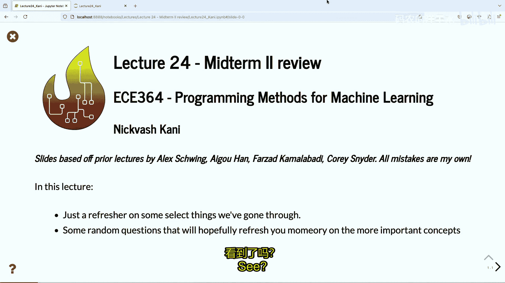
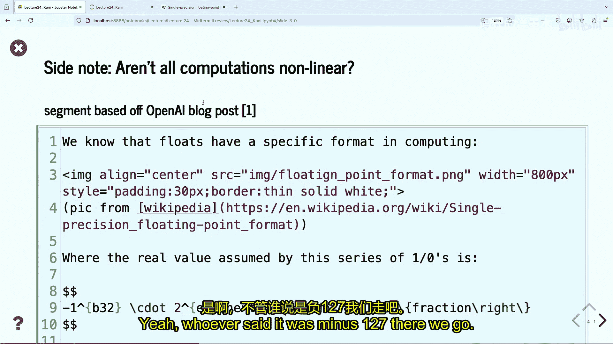
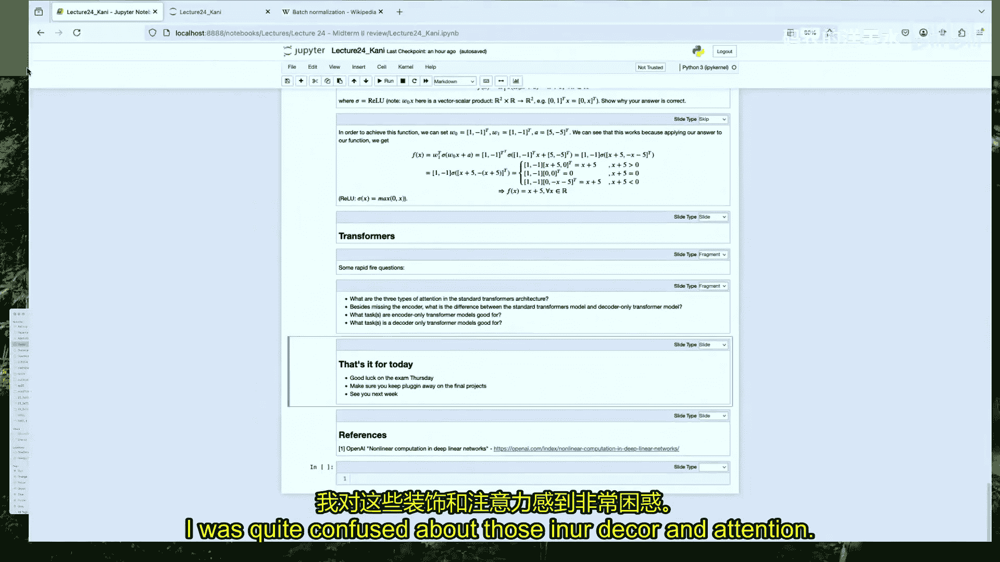

# 024：期末复习




在本节课中，我们将对课程后半部分的核心概念进行复习。我们将通过分析典型问题，回顾深度神经网络、卷积层、参数计算、网络设计以及Transformer架构等关键知识点，确保大家为考试做好充分准备。

---

## 网络结构与激活函数

上一节我们介绍了课程的整体复习范围，本节中我们来看看一个基础但关键的概念：网络层间的非线性激活函数。

观察以下两层网络代码：
```python
z = x @ w1
y = z @ w2
```
这段代码存在一个根本性问题。如果不在两个线性层之间引入非线性变换，那么整个网络在功能上等价于单个线性变换 `y = x @ (w1 @ w2)`。这极大地限制了网络学习复杂模式的能力。




因此，必须在每个线性层之后添加非线性激活函数，以引入网络的表达能力。


以下是几种常见的非线性激活函数：
*   **ReLU (Rectified Linear Unit)**：公式为 `f(x) = max(0, x)`。它将所有负输入置零，正输入原样输出。
*   **Sigmoid**：公式为 `f(x) = 1 / (1 + e^{-x})`。它将输入压缩到 (0, 1) 区间，常用于输出概率。
*   **Tanh**：公式为 `f(x) = (e^{x} - e^{-x}) / (e^{x} + e^{-x})`。它将输入压缩到 (-1, 1) 区间，输出均值为零。

此外，对于分类任务，网络的最后一层通常需要根据损失函数选择适当的输出层，例如 **Softmax** 函数（用于多分类交叉熵损失）或直接使用 **逻辑值**（用于二元交叉熵损失）。

---

## 卷积层输出计算

理解了基础网络结构后，我们来看看卷积神经网络中的具体操作。本节中我们将练习计算卷积层的输出尺寸和数值。

**问题一**：给定一个 4x4 的输入矩阵和一个 2x2 的卷积核，步长为1，填充为0，无偏置和激活函数。输出矩阵的尺寸是多少？具体数值是什么？

计算过程遵循公式：输出尺寸 = `(输入尺寸 - 核尺寸) / 步长 + 1`。因此，输出是一个 3x3 的矩阵。通过卷积运算（对应元素相乘后求和），我们可以得到具体的输出值。

**问题二**：给定一个 4x4 的输入矩阵，使用一个 2x1 的卷积核，在行方向上的步长为2，在列方向上的步长为1。输出矩阵的尺寸是多少？

这里需要注意，卷积核不一定是方形的，且步长可以在不同维度上不同。根据公式分别计算行和列的输出尺寸即可。

---

## 网络参数数量估计

在构建和优化神经网络时，了解模型的参数量至关重要。本节我们将学习如何逐层计算网络中的可学习参数总数。

考虑一个包含以下层的网络：
1.  输入：3通道的4x4图像。
2.  BatchNorm2d 层（特征数=3）。
3.  卷积层：输入通道3，输出通道6，3x3卷积核。
4.  最大池化层：2x2核，步长2。
5.  线性层：将特征映射到10维输出。

以下是各层参数的计算方法：
*   **BatchNorm2d层**：对于每个通道，有两个可学习参数（缩放因子γ和偏移因子β）。3个通道共有 `3 * 2 = 6` 个参数。
*   **卷积层**：参数数量 = `输入通道数 * 卷积核高度 * 卷积核宽度 * 输出通道数`。即 `3 * 3 * 3 * 6 = 162` 个参数（假设无偏置）。
*   **最大池化层**：没有可学习参数，参数数量为0。
*   **线性层**：需要先确定其输入维度。经过前面的卷积和池化后，特征图尺寸变为1x1，通道数为6。因此线性层输入维度为6。参数数量 = `输入维度 * 输出维度 + 输出维度`（偏置）。即 `6 * 10 + 10 = 70` 个参数。

将各层参数相加，得到网络总参数量为 `6 + 162 + 0 + 70 = 238`。

---

## 手动设计简单网络权重

有时，我们可以根据目标函数直接推导出网络权重，而无需训练。本节我们通过一个具体问题来演示这一思路。

**问题**：设计一个简单的两层网络，使其实现函数 `f(x) = x + 5`。网络结构如下：`y = w1^T * ReLU(w0 * x + a)`，其中 `w0` 和 `a` 是二维向量，`w1` 是二维权重向量。求 `w0`, `w1`, `a` 的值。

**思路**：关键在于利用 ReLU 的特性 `ReLU(x) = max(0, x)`。我们可以构造权重，使得对于任意输入 `x`，网络内部路径能“选择”正确的线性变换。
一种可行的解决方案是：
*   令 `w0 = [1, -1]^T`，`a = [5, -5]^T`，`w1 = [1, -1]`。
*   当 `x >= -5` 时（即 `x+5 >= 0`），第一条路径激活，计算为 `(x+5) * 1`。
*   当 `x < -5` 时，第二条路径激活，计算为 `(-(x+5)) * (-1) = x+5`。
*   最终，无论 `x` 取何值，输出均为 `x+5`。

此问题考察了对激活函数行为以及权重如何组合以实现特定输入输出映射的理解。

---

## Transformer 架构回顾

最后，我们复习一下Transformer模型的核心概念。Transformer是当前自然语言处理领域的基石模型。




在标准的编码器-解码器Transformer架构中，存在三种注意力机制：
*   **自注意力**：在编码器中，用于计算输入序列所有位置之间的关系。
*   **掩码自注意力**：在解码器中，为了防止模型在训练时“看到”未来的信息，对当前位置之后的信息进行掩码。
*   **编码器-解码器注意力**：在解码器中，允许解码器关注编码器输出的所有位置，用于像翻译这样的任务。

**仅解码器模型**（如GPT系列）与标准Transformer的主要区别在于：它移除了整个编码器部分，因此也**没有编码器-解码器注意力层**。它仅使用掩码自注意力，适用于文本生成任务。

**仅编码器模型**（如BERT）则移除了解码器部分。它们擅长对输入文本进行理解和分析，常用于文本分类、情感分析或问答（当答案是抽取式而非生成式时）等任务。

---


本节课中我们一起复习了深度神经网络的核心组件、卷积运算、模型参数计算、网络权重设计的逻辑以及Transformer架构的不同类型及其适用场景。希望这些内容能帮助大家巩固所学知识，在考试中取得好成绩。请继续完善你们的期末项目，祝大家好运！