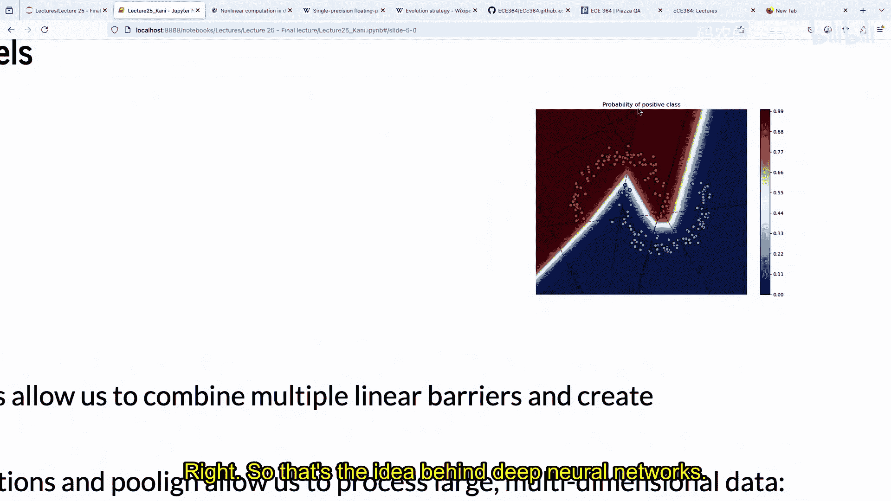
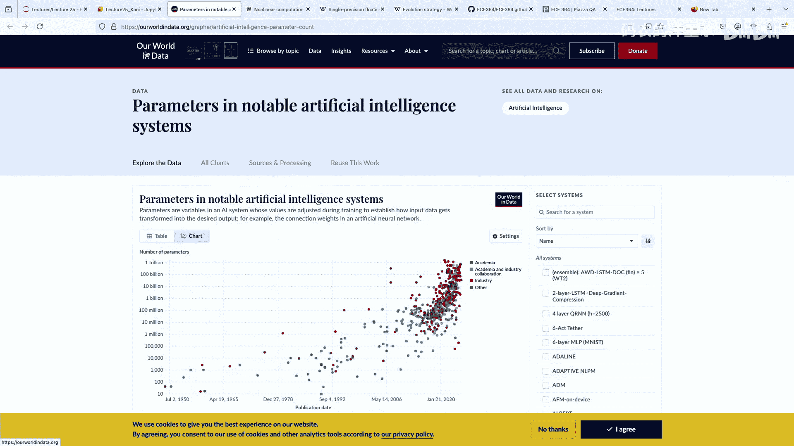
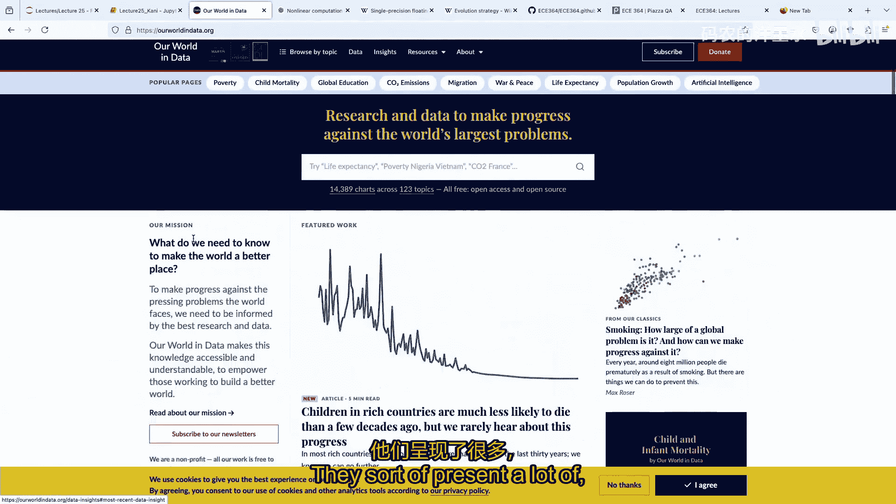
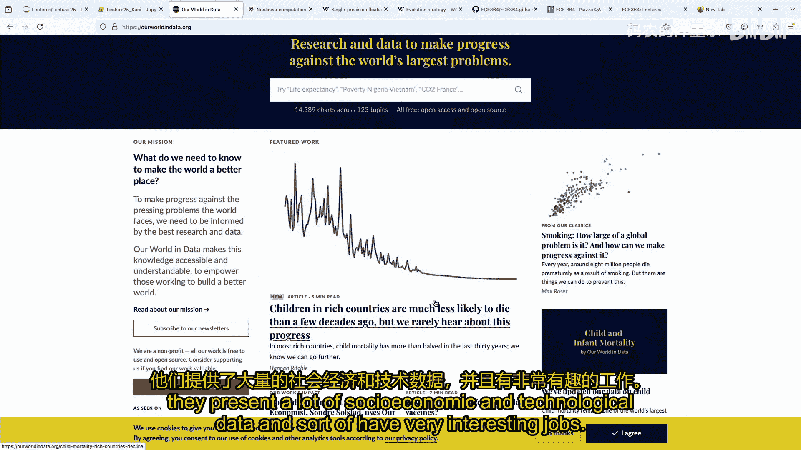
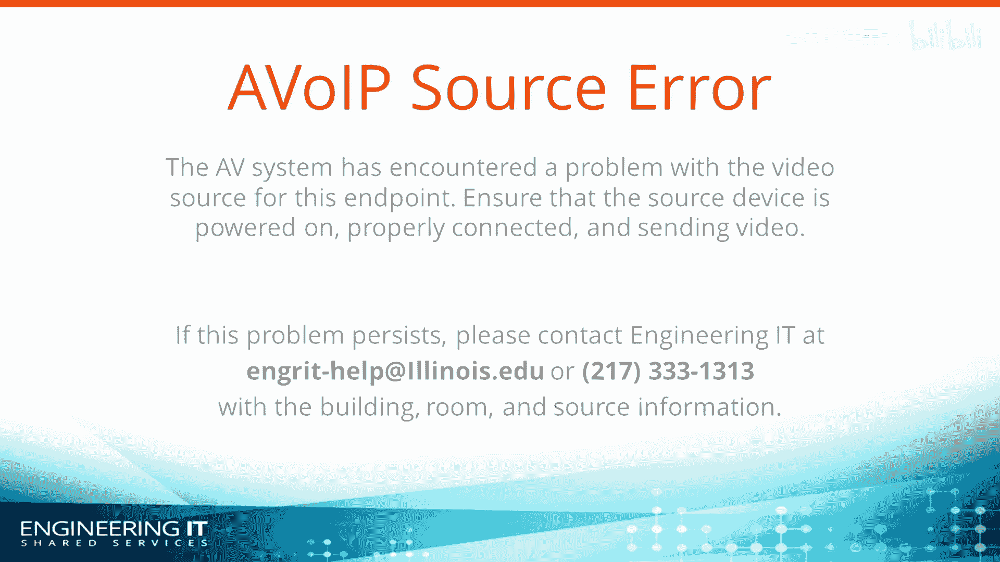

# 025：展望未来

在本节课中，我们将回顾本学期所学的核心内容，并探讨机器学习领域当前的一些趋势和未来方向。我们将从基础工具到前沿模型进行梳理，并思考人工智能发展的根本问题。

## 课程回顾：我们学到了什么

上一节我们介绍了本课程的整体结构，本节中我们来详细回顾一下本学期所学的核心知识体系。

我们首先学习了基础工具和方法。

以下是我们在课程初期掌握的关键技能：
*   **Python技能提升**：重点掌握了矩阵和张量的切片与操作，理解了视图的概念。
*   **数学基础巩固**：掌握了机器学习中至关重要的矩阵微积分，例如公式 `d(x^2)/dx = 2x`，以及梯度下降等核心概念。
*   **线性代数复习**：为后续的模型理解打下了坚实的数学基础。
*   **框架掌握**：深入学习了 **PyTorch** 和 scikit-learn，尤其是 PyTorch，它目前已成为机器学习领域主流的编程范式。

接着，我们深入探讨了优化方法与计算图。

我们学习了如何构建计算图，并理解从简单节点到拥有数十亿参数的大型模型的计算图本质上只是规模的扩展，其原理是相通的。这就像编译器的发展历程，从最初的手动汇编到如今的自动编译，信任建立在反复验证之上。

然后，我们讨论了原始优化方法，特别是梯度下降的各种变体。

由于计算资源有限，梯度下降在实践中会遇到梯度消失、过拟合、欠拟合、训练不稳定等问题。通过学习如何修改梯度下降算法（即原始优化），我们可以更快地收敛到局部最优解。虽然 PyTorch 的优化器和数据集类为我们自动化了这些过程，但了解其工作原理有助于我们更好地信任和使用这些工具。

之后，我们进入了分类方法的学习。

我们讨论了线性和逻辑回归，其核心是在有标签的数据集上寻找决策边界以进行分类。我们还探讨了支持向量机，它是逻辑回归的一种抽象，其核心思想是只关注最靠近决策边界的样本点（支持向量），并试图最大化分类间隔，从而对异常值更鲁棒。

在期中考试之后，我们开始接触更深入的主题。

我们讨论了深度学习网络。

我们比较了监督学习与无监督学习。监督学习处理所有数据都有标签的情况，而无监督学习则用于处理现实世界中大量无标签的数据。我们学习了几种无监督技术，包括主成分分析、聚类和高斯混合模型。

我们深入探讨了神经网络方法。

深度神经网络的核心技巧在于，通过叠加多个线性层，可以组合出复杂的非线性决策边界，从而对更复杂的数据进行分类。公式上，这可以看作多个线性变换与非线性激活函数的复合：`output = activation(W3 * activation(W2 * activation(W1 * input + b1) + b2) + b3)`。

我们还将神经网络应用于图像领域。

我们学习了在图像处理中常用的深度神经网络，主要是那些使用卷积或池化操作来处理多维数据的网络结构。

接着，我们学习了循环模型。

循环模型是任何具有隐藏状态（记忆）的模型，用于处理可变长度的序列数据。

最后，我们以Transformer模型结束本学期的课程。

Transformer模型是目前众多模型的基石，其秘密在于引入了注意力机制。这个机制允许模型将序列的不同部分相互关联（例如将名词与其形容词关联起来）。尽管其为何如此有效仍不完全清楚，但我们知道它确实工作得非常好，并催生了所有现代大型语言模型。

从简单的线性代数开始，到理解支撑GPT等模型的Transformer架构，我们走过的每一步单独来看都不复杂。重要的是理解，许多前沿技术并非遥不可及，它们往往是基础概念的规模化应用。

## 后续学习方向

我们已经涵盖了机器学习的广泛主题，但学无止境。对于未来希望深入学习的方向，这里有一些课程建议。

以下是几门值得考虑的后续课程：
*   **EE 544 模式识别**：更深入地探讨本课程涉及主题的理论基础，特别是概率论方面。
*   **CS 498 特定主题课程（如LLM工程推理）**：专注于大型语言模型的评估与理解，可能更偏理论。
*   **CS 443 强化学习**：将机器学习应用于结构化环境（如游戏），通过奖励函数训练智能体，在金融交易等领域有应用。
*   **CS 444 计算机视觉**：专注于图像相关的机器学习应用。
*   **CS 447 自然语言处理**：专注于文本数据处理、分词、掩码语言建模等特定于语言的任务和技术。

## 当前趋势与未来思考

回顾过去之后，本节我们来看看机器学习领域当前的一些观察和未来可能面临的挑战。

首先，一个明显的趋势是模型规模持续增大。

参数数量呈指数级增长，例如DeepSeek-V3拥有6700亿参数。自2015年左右NVIDIA CUDA等关键技术推出后，模型规模的增长显著加速。从1950年Claude Shannon简单的迷宫寻路“AI”，到今天模拟人类行为的大型模型，发展令人惊叹。

然而，在规模增大的同时，也有研究提示我们反思。

有观点认为，模型不一定需要无限变大。例如，**Phi-1** 模型通过精心筛选高质量训练数据（如优秀的Stack Overflow代码示例），仅用13亿参数就在代码生成任务上达到了比某些更大模型更好的效果。这提示我们，数据质量可能与数据数量同等重要。

另一方面，训练成本正变得极其高昂。

训练如GPT-4这样的模型可能需要9500万天的计算量，成本高达数千万美元。训练数据集的大小和要求也在指数级增长。有分析预测，按照当前趋势，到2030年左右，对高质量训练数据的需求可能会接近互联网可用数据的总量上限，这可能成为发展的瓶颈。

关于大型语言模型是否具备真正的智能，目前存在激烈争论。

以下是支持和反对“LLM具有智能”观点的一些论据：
*   **支持方**：Google研究显示其模型能在数学奥林匹克竞赛中达到银牌水平；Anthropic的研究通过“归因图”技术分析模型内部状态，认为其展示了类似思考的中间推理步骤。
*   **反对方**：有研究通过构建精细的数学问题数据集发现，LLM整体表现一般（约50-80%正确率），且常出现循环论证、记忆固化、推理过程有缺陷等问题；另有研究针对全新的、未出现在训练数据中的数学奥赛题目进行测试，发现主流LLM几乎全部失败，表明其泛化能力可能有限，而非真正理解。

这些争论让我们回到一个根本性问题：我们当前开发的模型，是通向超越人类智能的“Multivac”（艾萨克·阿西莫夫科幻小说中的超级计算机）的萌芽，还是仅仅是在复述和重组人类知识的“鹦鹉”？

本节课中我们一起回顾了从基础线性代数到前沿Transformer的机器学习核心路径，探讨了模型规模化、数据质量与成本等当前趋势，并审视了关于AI智能本质的深刻争论。无论未来如何，仍有大量工作等待完成。本学期的课程至此结束，所有作业和考试评分将按计划完成。祝大家未来一切顺利，保持思考。